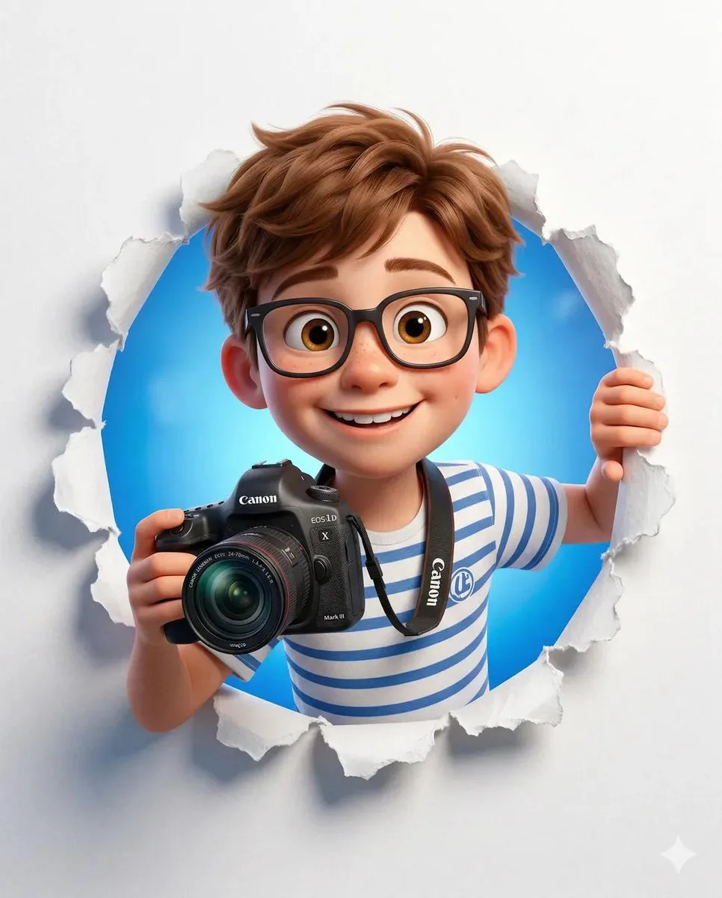

# Taaruk — by @Taaruk_

[← Back to Examples from X](../../EXAMPLES.md) · Category: Illustration & 3D · Model: `Nano Banana`

<a href="https://x.com/Taaruk_/status/2041739710490726845"></a>

Original post: **[@Taaruk_ on X](https://x.com/Taaruk_/status/2041739710490726845)** · Creator: [Taaruk](https://x.com/Taaruk_)

## Prompt

```text
A cute stylized 3D cartoon character (boy/girl) with big expressive eyes, soft smooth skin, and round facial features, wearing glasses and a casual striped t-shirt, holding a professional DSLR camera. The character is emerging through a torn paper hole in a clean white wall, with realistic ripped paper edges and depth. Behind the hole is a bright blue gradient background, creating contrast. The character is smiling directly at the viewer, vibrant and friendly mood, Pixar-style rendering, ultra-detailed textures, soft studio lighting, high realism, 8K resolution.
```

## Try it

Paste the prompt into **[vinano.ai](https://vinano.ai?utm_source=github&utm_medium=readme&utm_campaign=awesome-image-video-prompts-updating&utm_content=x-page-try)** to generate your own version.

> The image and prompt belong to [@Taaruk_](https://x.com/Taaruk_) and are shown here with credit for reference. Creators can ask for changes or removal by opening an issue.
