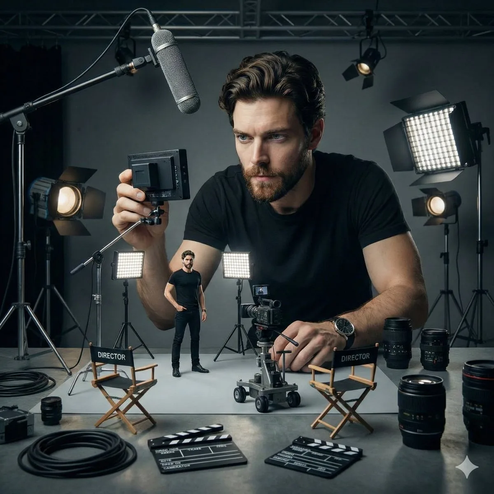

# 𝐌 — by @Strength04_X

[← Back to Community Examples](../../EXAMPLES.md) · Category: Photography · Model: `Nano Banana`

<a href="https://x.com/Strength04_X/status/2015380025365938616"></a>

Source: **[@Strength04_X on X](https://x.com/Strength04_X/status/2015380025365938616)** · Creator: [𝐌](https://x.com/Strength04_X)

## Prompt

```text
Ultra-realistic cinematic studio scene of a woman supervising a miniature behind-the-scenes film set starring her tiny self.

She checks a miniature monitor while the small figure stands near scaled lighting rigs.

Both versions share identical facial features, body language, and clothing.

Mini director chairs, cables, clapperboards, and lenses fill the studio space.

Low-key cinematic lighting emphasizes realism and depth.
```

## Try it

Paste the prompt into **[vinano.ai](https://vinano.ai?utm_source=github&utm_medium=readme&utm_campaign=awesome-image-video-prompts-updating&utm_content=x-page-try)** to generate your own version.

> The image and prompt belong to @Strength04_X ([original post](https://x.com/Strength04_X/status/2015380025365938616)) and are shown here with credit for reference. Creators can ask for changes or removal by opening an issue.
