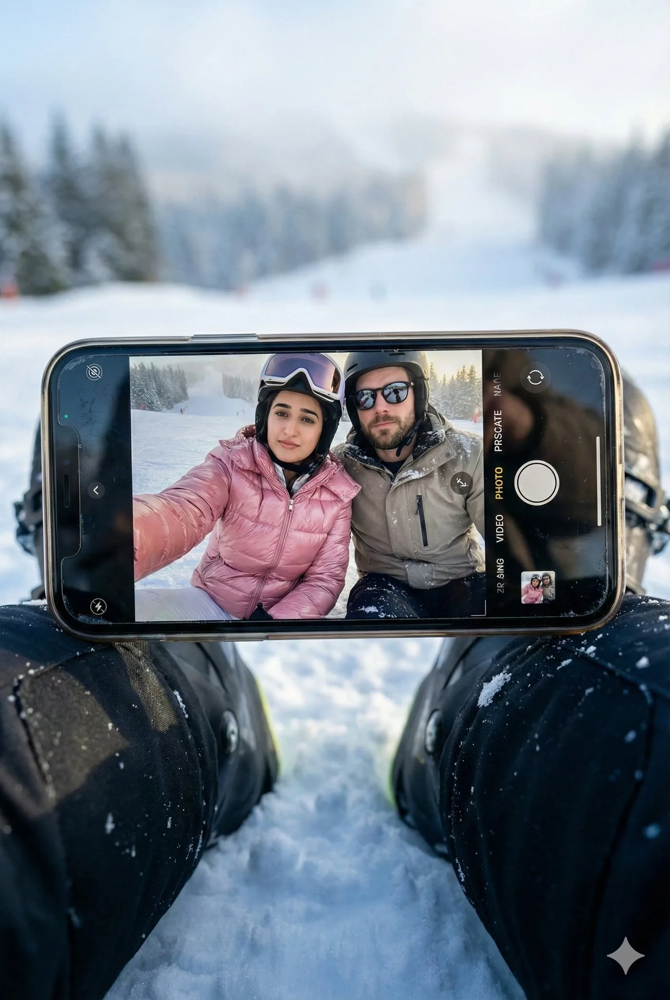

# 𝐌 — by @Strength04_X

[← Back to Examples from X](../../EXAMPLES.md) · Category: Photography · Model: `Nano Banana`

<a href="https://x.com/Strength04_X/status/2008361785322336674"></a>

Original post: **[@Strength04_X on X](https://x.com/Strength04_X/status/2008361785322336674)** · Creator: [𝐌](https://x.com/Strength04_X)

## Prompt

```text
Create a hyper-realistic winter scene in a vertical 3:4 aspect ratio with cinematic realism and natural detail. The foreground features compacted snow with subtle ice sparkle, cool blue shadows, and cold ambient light. A smartphone is placed perfectly horizontally across black ski boots, stable and centered, with visible smudges, micro-reflections, edge highlights, and slight screen glare. The iPhone camera Ul is clearly visible, including icons and the shutter button, reinforcing an authentic, unedited iPhone capture. On the phone screen, Subject 1 and Subject 2 are seated closely together on the snow, framed from a low angle so only their upper bodies are visible, creating an intimate mirror-selfie-style composition. Subject 2 sits slightly forward, holding the phone at arm's length with the phone back visible, wearing a glossy pink puffer jacket with realistic quilting, natural folds, helmet, and goggles; her face is fully clear and visible with a relaxed, confident expression. Subject 1 sits directly beside her, shoulders nearly touching, wearing a neutral ski jacket with light snow dusting, a helmet, and dark sunglasses reflecting the snowy environment: his face is also fully clear and visible, with a calm, relaxed posture. The background within the screen shows a snowy slope and distant ski-area elements softened by realistic depth and atmospheric haze. Lighting blends cool winter tones with warm sunlight reflections, producing natural shadows, lifelike highlights, and subtle imperfections. The final image must feel HD, realistic, candid, and cinematic, with both subjects facial features preserved exactly and remaining 1000% identical to the uploaded images.
```

## Try it

Paste the prompt into **[vinano.ai](https://vinano.ai?utm_source=github&utm_medium=readme&utm_campaign=awesome-image-video-prompts-updating&utm_content=x-page-try)** to generate your own version.

> The image and prompt belong to [@Strength04_X](https://x.com/Strength04_X) and are shown here with credit for reference. Creators can ask for changes or removal by opening an issue.
