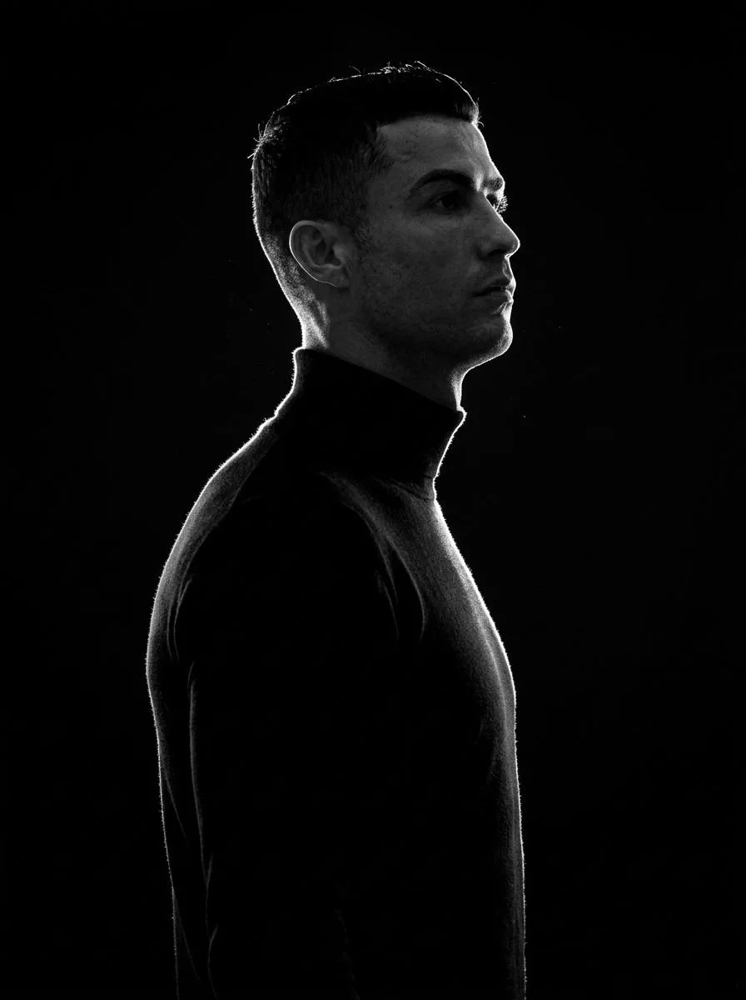

# Taaruk — by @Taaruk_

[← Back to Examples from X](../../EXAMPLES.md) · Category: Photography · Model: `Nano Banana`

<a href="https://x.com/Taaruk_/status/2041463539047735472"></a>

Original post: **[@Taaruk_ on X](https://x.com/Taaruk_/status/2041463539047735472)** · Creator: [Taaruk](https://x.com/Taaruk_)

## Prompt

```text
A minimalist black and white cinematic portrait featuring two individuals (male and female) in strict side profile, both facing the same direction with calm, introspective expressions, wearing elegant black turtlenecks. The scene is set against a pure black background with dramatic rim lighting outlining their facial contours and hair strands. High contrast lighting creates deep shadows and soft highlights, emphasizing sharp facial structure and texture. Fine art editorial photography style, ultra-realistic, clean composition, subtle film grain, 8K resolution.
```

## Try it

Paste the prompt into **[vinano.ai](https://vinano.ai?utm_source=github&utm_medium=readme&utm_campaign=awesome-image-video-prompts-updating&utm_content=x-page-try)** to generate your own version.

> The image and prompt belong to [@Taaruk_](https://x.com/Taaruk_) and are shown here with credit for reference. Creators can ask for changes or removal by opening an issue.
