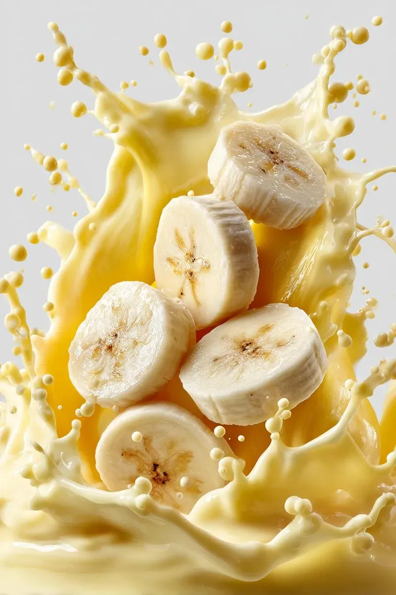

# Sharon Riley — by @Just_sharon7

[← Back to Examples from X](../../EXAMPLES.md) · Category: Food & Drink · Model: `Nano Banana`

<a href="https://x.com/Just_sharon7/status/2013660094664446322"></a>

Original post: **[@Just_sharon7 on X](https://x.com/Just_sharon7/status/2013660094664446322)** · Creator: [Sharon Riley](https://x.com/Just_sharon7)

## Prompt

```text
{
"subject": {
    "primary": "Vibrant orange slices",
    "action": "Falling through the air toward rising milk",
    "secondary": "Thick, glossy white milk splash forming arcs and crown-like curves",
    "details": "Milk droplets frozen mid-air with creamy texture"
  },
  "environment": {
    "background": "Clean blue studio backdrop",
    "lighting": "Cinematic soft studio lighting with dramatic highlights and shadows"
  },
  "visual_style": {
    "genre": "Ultra-realistic commercial splash photography",
    "textures": "High-detail creamy milk and fresh citrus pulp",
    "motion": "Frozen action, high-speed capture",
    "depth_of_field": "Shallow depth of field"
  },
  "camera": {
    "lens": "85mm macro",
    "framing": "Wide composition",
    "focus": "Sharp focus on splash and fruit"
  },
  "composition": {
    "aspect_ratio": "3:4",
    "color_palette": ["Vibrant Orange", "Pure White", "Clean Blue"]
  },
  "quality": {
    "detail_level": "Ultra-high detail",
    "rendering": "Photorealistic"
  },
  "profile": "9ewnbdc"
}
```

## Try it

Paste the prompt into **[vinano.ai](https://vinano.ai?utm_source=github&utm_medium=readme&utm_campaign=awesome-image-video-prompts-updating&utm_content=x-page-try)** to generate your own version.

> The image and prompt belong to [@Just_sharon7](https://x.com/Just_sharon7) and are shown here with credit for reference. Creators can ask for changes or removal by opening an issue.
