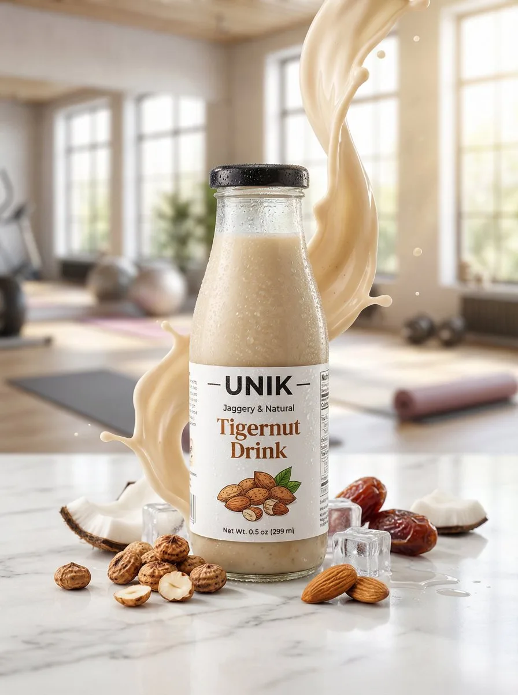

# Oogie — by @oggii_0

[← Back to Community Examples](../../EXAMPLES.md) · Category: Photography · Model: `Nano Banana`

<a href="https://x.com/oggii_0/status/2033147596727001224"></a>

Source: **[@oggii_0 on X](https://x.com/oggii_0/status/2033147596727001224)** · Creator: [Oogie](https://x.com/oggii_0)

## Prompt

```text
Ultra-realistic lifestyle beverage advertisement featuring a chilled bottle of “UNIK – Jaggery & Natural Tigernut Drink.” The bottle stands on a clean marble or gym countertop surrounded by natural ingredients such as tigernuts, almonds, coconut slices, and dates. A smooth splash of creamy tigernut milk flows upward behind the bottle while ice cubes scatter around it. The bottle is covered with condensation droplets indicating cold freshness. The background features a bright modern fitness studio with soft natural lighting and blurred gym equipment. The composition communicates energy, health, and natural nutrition. High-end commercial beverage photography, macro details, shallow depth of field, ultra-realistic textures, photorealistic lighting, clean advertising style, 8K resolution.
```

## Try it

Paste the prompt into **[vinano.ai](https://vinano.ai?utm_source=github&utm_medium=readme&utm_campaign=awesome-image-video-prompts-updating&utm_content=x-page-try)** to generate your own version.

> The image and prompt belong to @oggii_0 ([original post](https://x.com/oggii_0/status/2033147596727001224)) and are shown here with credit for reference. Creators can ask for changes or removal by opening an issue.
