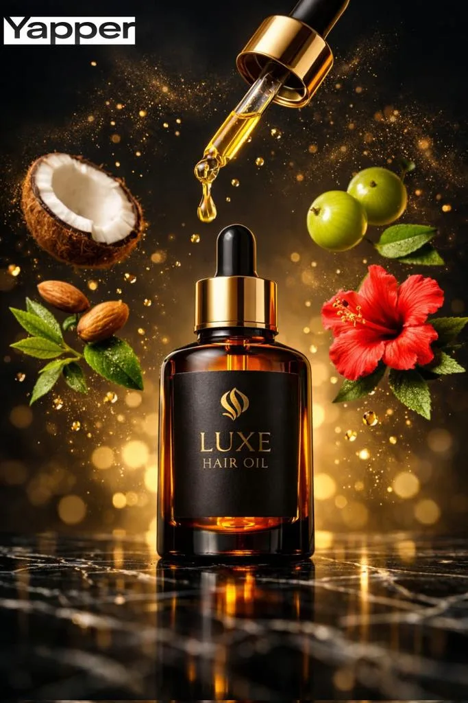

# Meem — by @mehvishs25

[← Back to Community Examples](../../EXAMPLES.md) · Category: Product & Brand · Model: `Nano Banana`

<a href="https://x.com/mehvishs25/status/2029369297030807801"></a>

Source: **[@mehvishs25 on X](https://x.com/mehvishs25/status/2029369297030807801)** · Creator: [Meem](https://x.com/mehvishs25)

## Prompt

```text
{
  "master_prompt": {
    "scene_type": "ultra-premium cinematic luxury hair oil product photography",

    "product": {
      "type": "luxurious branded herbal hair oil",
      "container": "premium dark amber glass bottle with elegant gold dropper cap",
      "label": "minimal luxury branding with embossed gold typography",
      "oil_texture": "rich golden oil with crystal clarity and glossy viscosity",
      "ingredients_visual": [
        "fresh coconut halves",
        "amla berries",
        "almonds",
        "hibiscus flowers",
        "green herbal leaves"
      ]
    },

    "composition": {
      "action": "golden hair oil droplets pouring elegantly from a glass dropper captured mid-air",
      "surrounding_elements": [
        "floating herbal ingredients suspended in motion",
        "tiny golden oil droplets sparkling in light",
        "soft mist of botanical particles",
        "subtle golden dust accents for premium feel"
      ],
      "placement": "hero bottle centered on polished black marble surface with luxury reflections"
    },

    "lighting": {
      "style": "luxury cosmetic studio lighting",
      "effects": [
        "soft rim lighting outlining the bottle silhouette",
        "warm backlight illuminating the golden oil inside the bottle",
        "gentle top light highlighting the glass dropper and oil droplets",
        "subtle side lighting enhancing glass reflections"
      ]
    },

    "color_palette": {
      "background": "deep charcoal fading into warm golden bokeh",
      "accents": "rich amber gold, botanical green, glossy black reflections, subtle champagne highlights"
    },

    "technical_specs": {
      "camera": "macro lens with slight low angle for premium dominance",
      "shutter": "ultra-fast freeze motion capturing oil droplets",
      "depth_of_field": "shallow focus on bottle and dropper with cinematic background blur",
      "quality": "8K resolution, ultra-photorealistic cosmetic product detailing"
    }
  }
}
```

## Try it

Paste the prompt into **[vinano.ai](https://vinano.ai?utm_source=github&utm_medium=readme&utm_campaign=awesome-image-video-prompts-updating&utm_content=x-page-try)** to generate your own version.

> The image and prompt belong to @mehvishs25 ([original post](https://x.com/mehvishs25/status/2029369297030807801)) and are shown here with credit for reference. Creators can ask for changes or removal by opening an issue.
