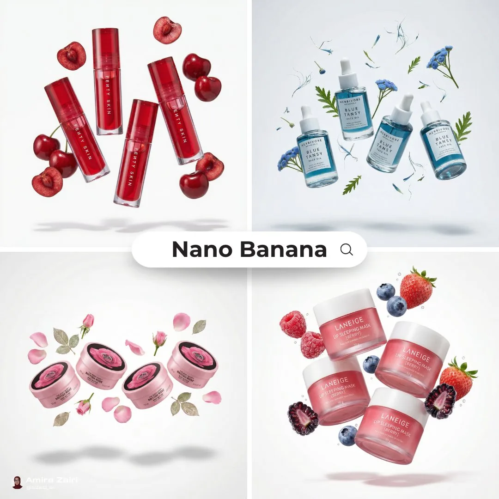

# Amira Zairi — by @azed_ai

[← Back to Community Examples](../../EXAMPLES.md) · Category: Product & Brand · Model: `Nano Banana`

<a href="https://x.com/azed_ai/status/2023760359493194030"></a>

Source: **[@azed_ai on X](https://x.com/azed_ai/status/2023760359493194030)** · Creator: [Amira Zairi](https://x.com/azed_ai)

## Prompt

```text
[product], 3–4 identical units of the product floating in mid-air, surrounded by fresh [fruit/vegetable] and sliced pieces that the product is made from, ingredients suspended around the product, dynamic balanced composition, ultra-clean pure white background, no gradients, no color cast, soft studio lighting, realistic soft shadows beneath floating objects, glossy packaging reflections, juicy ingredient textures, premium skincare editorial style, hyper-realistic product photography, macro detail, sharp focus, commercial advertising quality, minimal composition, 8k, 1:1
```

## Try it

Paste the prompt into **[vinano.ai](https://vinano.ai?utm_source=github&utm_medium=readme&utm_campaign=awesome-image-video-prompts-updating&utm_content=x-page-try)** to generate your own version.

> The image and prompt belong to @azed_ai ([original post](https://x.com/azed_ai/status/2023760359493194030)) and are shown here with credit for reference. Creators can ask for changes or removal by opening an issue.
