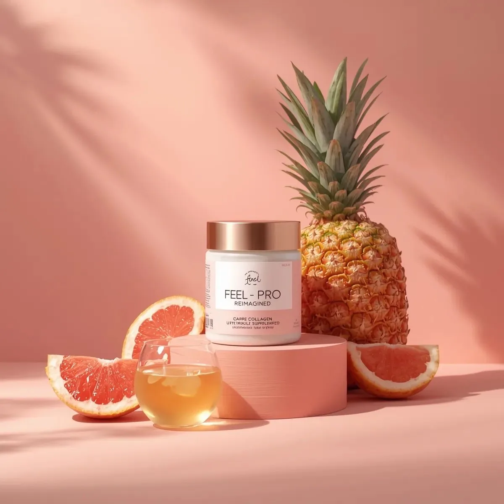

# Kashberg — by @Kashberg_0

[← Back to Community Examples](../../EXAMPLES.md) · Category: Product & Brand · Model: `Nano Banana`

<a href="https://x.com/Kashberg_0/status/2034201918571188405"></a>

Source: **[@Kashberg_0 on X](https://x.com/Kashberg_0/status/2034201918571188405)** · Creator: [Kashberg](https://x.com/Kashberg_0)

## Prompt

```text
Minimalist luxury product photography of a collagen supplement jar placed on a soft pastel peach background, cylindrical pedestal base, surrounded by fresh pineapple and sliced grapefruit, a small glass cup with golden liquid in front, warm sunlight casting soft palm leaf shadows, clean aesthetic, high-end skincare branding, soft diffused lighting, realistic textures, subtle reflections, shallow depth of field, editorial style, 4k, ultra-detailed.
```

## Try it

Paste the prompt into **[vinano.ai](https://vinano.ai?utm_source=github&utm_medium=readme&utm_campaign=awesome-image-video-prompts-updating&utm_content=x-page-try)** to generate your own version.

> The image and prompt belong to @Kashberg_0 ([original post](https://x.com/Kashberg_0/status/2034201918571188405)) and are shown here with credit for reference. Creators can ask for changes or removal by opening an issue.
