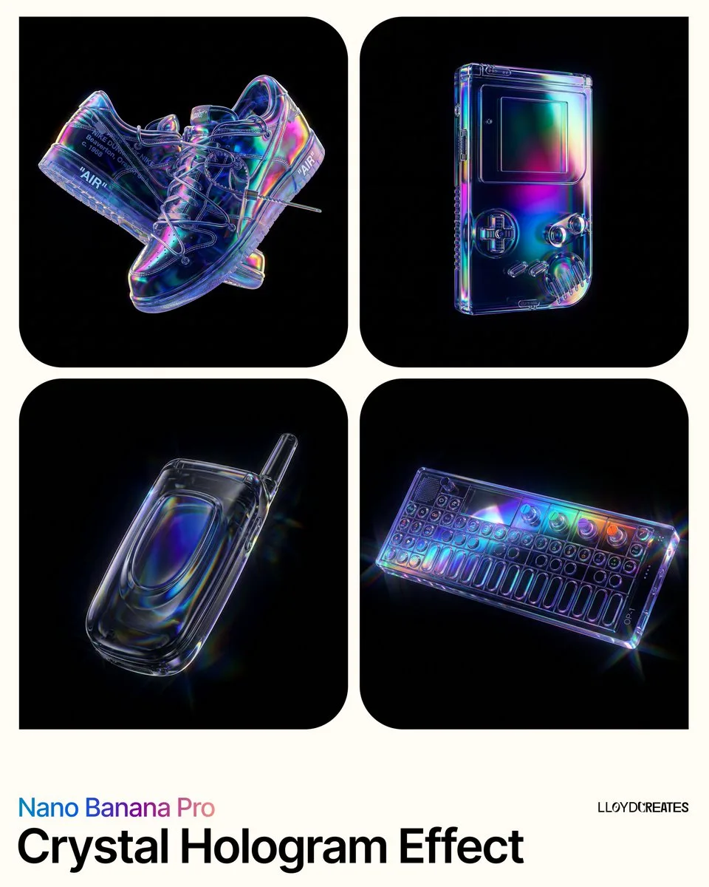

# Lloyd Creates — by @lloydcreates

[← Back to Examples from X](../../EXAMPLES.md) · Category: Illustration & 3D · Model: `Nano Banana`

<a href="https://x.com/lloydcreates/status/2021382862193426822"></a>

Original post: **[@lloydcreates on X](https://x.com/lloydcreates/status/2021382862193426822)** · Creator: [Lloyd Creates](https://x.com/lloydcreates)

## Prompt

```text
{
  "ultra_high_fidelity_request": {
    "subject": "[PRODUCT]",
    "framing": {
      "position": "Strictly centered and levitating",
      "boundary": "Full product visibility, zero cropping, isolated in 3D space",
      "background": "Solid pure black hex #000000"
    },
    "optical_effects": {
      "iridescence": "Extremely brilliant spectral iridescence, vivid neon oil-slick gradients",
      "volumetric": "Internal volumetric lighting, ethereal inner glow, light scattering within the material",
      "refraction": "High-index caustic light refraction, prismatic color splitting at the edges",
      "luminosity": "Super-saturated holographic highlights, intense electric blues and deep magentas"
    },
    "material_finish": {
      "texture": "Ultra-glossy liquid-smooth finish",
      "base": "Deep translucent obsidian glass with infinite depth",
      "reflections": "Crisp ray-traced mirror reflections of an invisible light source"
    },
    "negative_constraints": [
      "No platforms", "No floor", "No light boxes", "No softboxes", 
      "No props", "No text", "No shadows on surfaces", "No pedestals"
    ]
  }
}
```

## Try it

Paste the prompt into **[vinano.ai](https://vinano.ai?utm_source=github&utm_medium=readme&utm_campaign=awesome-image-video-prompts-updating&utm_content=x-page-try)** to generate your own version.

> The image and prompt belong to [@lloydcreates](https://x.com/lloydcreates) and are shown here with credit for reference. Creators can ask for changes or removal by opening an issue.
