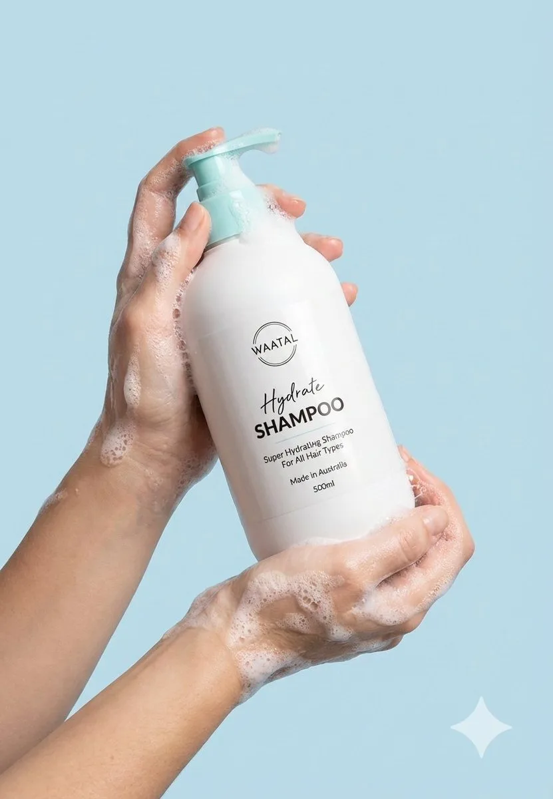

# Maercih — by @Maercihh

[← Back to Examples from X](../../EXAMPLES.md) · Category: Photography · Model: `Nano Banana`

<a href="https://x.com/Maercihh/status/2025163854469341484"></a>

Original post: **[@Maercihh on X](https://x.com/Maercihh/status/2025163854469341484)** · Creator: [Maercih](https://x.com/Maercihh)

## Prompt

```text
The soft touch.

Nano Banana pro on Gemini 

Prompt 

{
  "product_photography_prompt": {
    "subject": "Hands holding a shampoo bottle with lather.",
    "hands": {
      "description": "A person's hands with natural skin tone.",
      "action": "One hand holds the bottle, the other is cupped to catch foam.",
      "condition": "Covered in thick, white, bubbly soap lather."
    },
    "bottle": {
      "type": "Pump bottle.",
      "material": "Matte white plastic.",
      "dispenser": "Light blue pump.",
      "contents": "White shampoo, visible as foam."
    },
    "label": {
      "color": "White",
      "text_color": "Black",
      "logo": "Circular with 'WAATAL' inside.",
      "main_text": "Hydrate SHAMPOO (script and bold font).",
      "sub_text": "Super Hydrating Shampoo. For All Hair Types. Made in Australia. 500ml."
    },
    "foam": {
      "texture": "Thick, rich, bubbly lather.",
      "color": "White",
      "location": "Covering hands, bottle neck, and dispenser."
    },
    "background": {
      "color": "Solid soft light blue.",
      "texture": "Seamless, smooth studio background."
    },
    "lighting": {
      "type": "Soft, diffused studio lighting.",
      "direction": "Even illumination, highlighting foam texture and hands."
    },
    "style": {
      "type": "Clean, minimalist product photography.",
      "shot": "Close-up.",
      "focus": "Sharp focus on hands, bottle, and foam.",
      "mood": "Fresh, clean, natural."
    }
  }
}
```

## Try it

Paste the prompt into **[vinano.ai](https://vinano.ai?utm_source=github&utm_medium=readme&utm_campaign=awesome-image-video-prompts-updating&utm_content=x-page-try)** to generate your own version.

> The image and prompt belong to [@Maercihh](https://x.com/Maercihh) and are shown here with credit for reference. Creators can ask for changes or removal by opening an issue.
