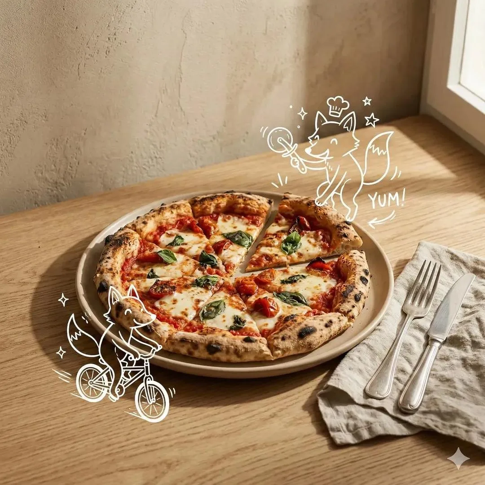

# simeon-sanai — by @Naiknelofar788

[← Back to Community Examples](../../EXAMPLES.md) · Category: Food & Drink · Model: `Nano Banana`

<a href="https://x.com/Naiknelofar788/status/2027544179560353948"></a>

Source: **[@Naiknelofar788 on X](https://x.com/Naiknelofar788/status/2027544179560353948)** · Creator: [simeon-sanai](https://x.com/Naiknelofar788)

## Prompt

```text
[product setup],create minimalist product photo, clean warm studio scene, textured beige wall background, soft directional sunlight creating long shadows, simple tabletop surface, product arranged in a playful concept composition, hand drawn white line doodle overlay of [character] interacting with the product, mixed media look combining real photography and sketch illustration, high end branding feel, shallow depth of field, ultra realistic, no extra text, no watermark, 8k, 1:1
```

## Try it

Paste the prompt into **[vinano.ai](https://vinano.ai?utm_source=github&utm_medium=readme&utm_campaign=awesome-image-video-prompts-updating&utm_content=x-page-try)** to generate your own version.

> The image and prompt belong to @Naiknelofar788 ([original post](https://x.com/Naiknelofar788/status/2027544179560353948)) and are shown here with credit for reference. Creators can ask for changes or removal by opening an issue.
