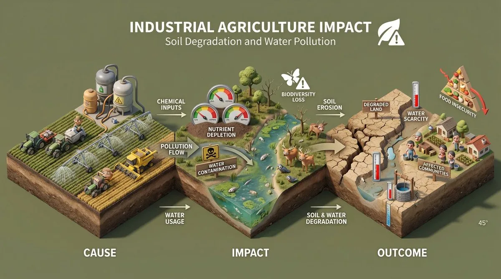

# Aleena Amir — by @aleenaamiir

[← Back to Examples from X](../../EXAMPLES.md) · Category: Illustration & 3D · Model: `Nano Banana`

<a href="https://x.com/aleenaamiir/status/2020421019002147321"></a>

Original post: **[@aleenaamiir on X](https://x.com/aleenaamiir/status/2020421019002147321)** · Creator: [Aleena Amir](https://x.com/aleenaamiir)

## Prompt

```text
“Build an isometric miniature 3D diorama explaining the environmental impact of [ACTIVITY OR PRODUCT].

Viewpoint stays near 45° from above.
Textures look realistic and balanced. Lighting feels soft and clear. The raised base splits into cause, impact, and outcome sections. Include visual indicators like meters, symbols, or levels.

Tiny stylized figures represent people, wildlife, or infrastructure. Figures have heavy facial details.

Background remains solid [BACKGROUND COLOR].
Top center text reads [TOPIC NAME] in bold.

Subtitle states the key impact in one line. A minimal environment icon appears below. Text switches between white or black for contrast.”
```

## Try it

Paste the prompt into **[vinano.ai](https://vinano.ai?utm_source=github&utm_medium=readme&utm_campaign=awesome-image-video-prompts-updating&utm_content=x-page-try)** to generate your own version.

> The image and prompt belong to [@aleenaamiir](https://x.com/aleenaamiir) and are shown here with credit for reference. Creators can ask for changes or removal by opening an issue.
