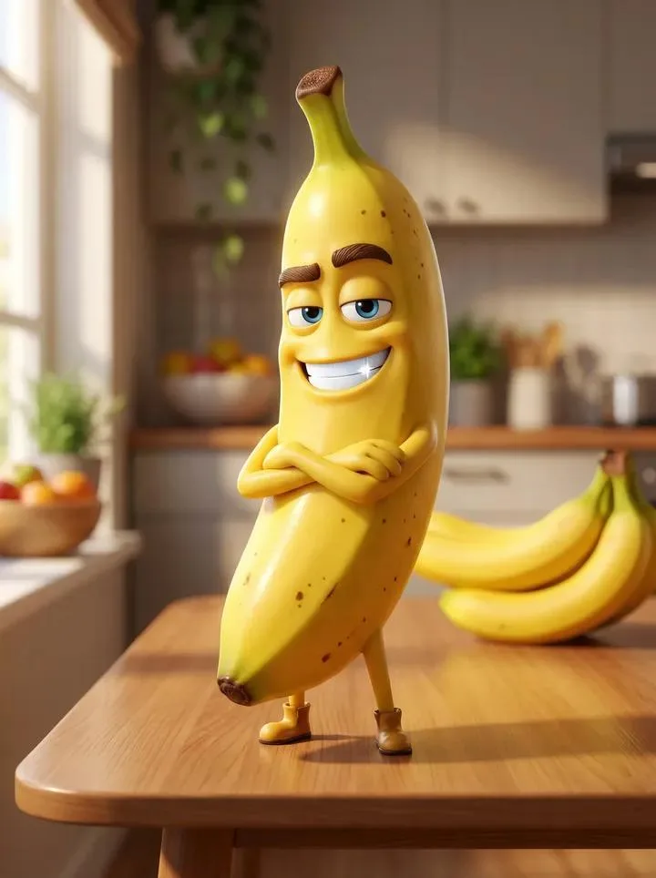

# 𝐌 — by @Strength04_X

[← Back to Community Examples](../../EXAMPLES.md) · Category: Illustration & 3D · Model: `Nano Banana`

<a href="https://x.com/Strength04_X/status/2025388911451848929"></a>

Source: **[@Strength04_X on X](https://x.com/Strength04_X/status/2025388911451848929)** · Creator: [𝐌](https://x.com/Strength04_X)

## Prompt

```text
A Pixar-style 3D animated character of a single banana. Handsome male character with sharp confident eyes, thick stylish eyebrows, and a wide charismatic grin showing bright white sparkling teeth. Smooth slightly glossy yellow peel texture with subtle highlights. The banana has small cartoon arms and legs, standing upright with arms crossed in a proud hero-like pose. Teeth are shiny and perfectly white with small sparkle effects. In the background, a bunch of bananas is slightly blurred.The character is standing on a wooden dining table near a sunny window in a cozy modern home. Vibrant colors, cinematic lighting, soft shadows, high-fidelity textures, ultra-detailed.
```

## Try it

Paste the prompt into **[vinano.ai](https://vinano.ai?utm_source=github&utm_medium=readme&utm_campaign=awesome-image-video-prompts-updating&utm_content=x-page-try)** to generate your own version.

> The image and prompt belong to @Strength04_X ([original post](https://x.com/Strength04_X/status/2025388911451848929)) and are shown here with credit for reference. Creators can ask for changes or removal by opening an issue.
