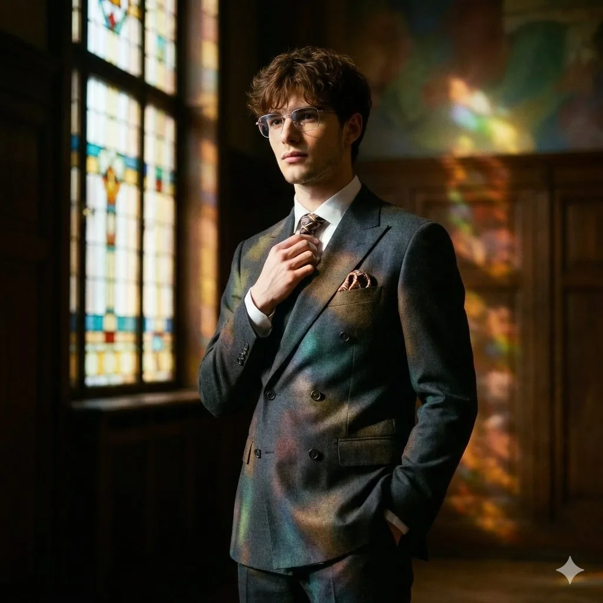

# Harboriis — by @harboriis

[← Back to Examples from X](../../EXAMPLES.md) · Category: Photography · Model: `Nano Banana`

<a href="https://x.com/harboriis/status/2022288144545259558"></a>

Original post: **[@harboriis on X](https://x.com/harboriis/status/2022288144545259558)** · Creator: [Harboriis](https://x.com/harboriis)

## Prompt

```text
Shot on a Hasselblad 907X 50C with an XCD 90mm f/2.5 lens, aperture f/2.8 shallow depth of field emphasizes the precision fit of the suit while the background dissolves into painterly color patches; captured in 16-bit RAW with high dynamic range and soft film grain to preserve wool texture and the glow of colored light without "harsh" digital sharpness. Frame a tight portrait cropped to mid-chest, at eye level, with a slight three-quarter turn; the model is offset from center so the stained-glass pattern reads in the negative space. The pose is calm and composed: shoulders open, posture confident but without tension; one hand neatly adjusts the tie knot or collar line, the other is in the trouser pocket, slightly opening the jacket and revealing the layered styling. Expression restrained and thoughtful; the gaze passes just past the lens, as if distant music is playing. Outfit a man in a suit with a retro accent: a structured double-breasted wool blazer with sharp lapels, high-waisted pleated trousers, a white shirt and narrow tie, polished Oxfords, and a minimal pocket square. Location a retro Art Deco hall with dark wood, brass, and a tall stained-glass window projecting jewel-like geometry onto the suit and background. Light warm practical fill from one side and colored stained-glass light from the other, cinematic contrast, "stained-glass" shadows. Result -retro editorial: graphic, refined, expensive, and timeless
```

## Try it

Paste the prompt into **[vinano.ai](https://vinano.ai?utm_source=github&utm_medium=readme&utm_campaign=awesome-image-video-prompts-updating&utm_content=x-page-try)** to generate your own version.

> The image and prompt belong to [@harboriis](https://x.com/harboriis) and are shown here with credit for reference. Creators can ask for changes or removal by opening an issue.
