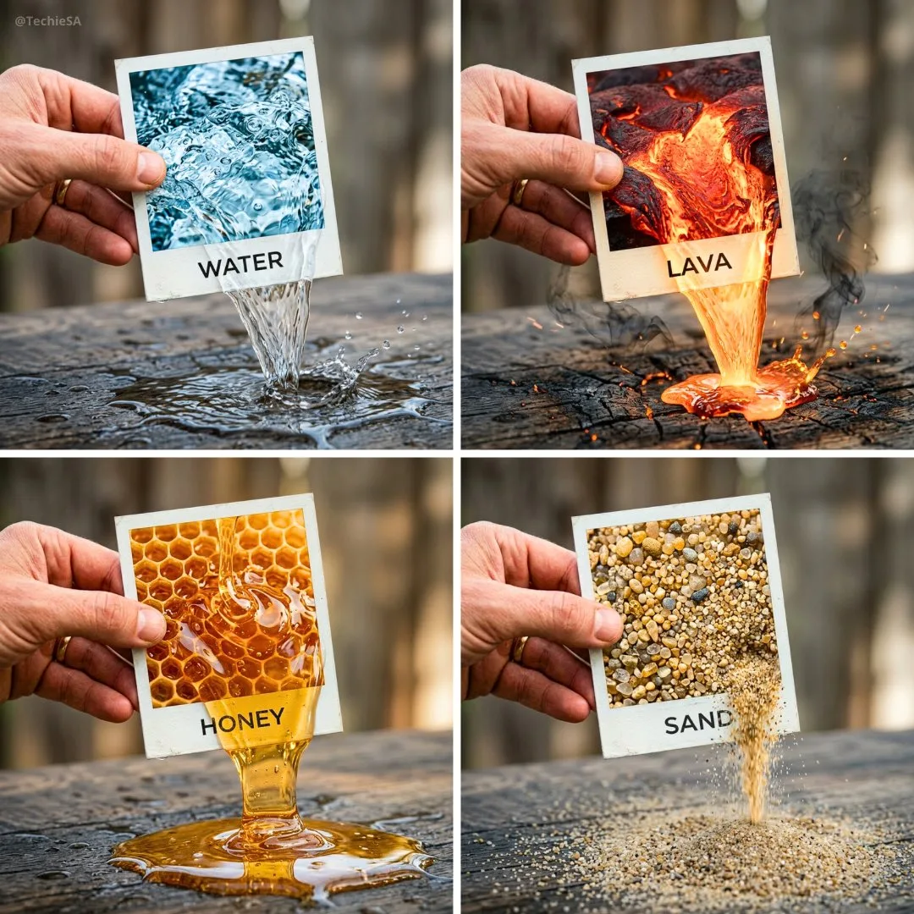

# TechieSA — by @TechieBySA

[← Back to Examples from X](../../EXAMPLES.md) · Category: Illustration & 3D · Model: `Nano Banana`

<a href="https://x.com/TechieBySA/status/2037633578519965864"></a>

Original post: **[@TechieBySA on X](https://x.com/TechieBySA/status/2037633578519965864)** · Creator: [TechieSA](https://x.com/TechieBySA)

## Prompt

```text
A hyper-realistic 3D photo concept showing a hand holding a square polaroid photo labeled “ELEMENT”. Inside the photo, there’s a close-up of [ELEMENT], and it flows seamlessly out of the photo frame into the real world, naturally interacting with the surface below. The text “ELEMENT” appears printed cleanly on the white border of the photo. Realistic cinematic lighting, ultra-detailed textures, artistic composition, 1080x1080 square format.
```

## Try it

Paste the prompt into **[vinano.ai](https://vinano.ai?utm_source=github&utm_medium=readme&utm_campaign=awesome-image-video-prompts-updating&utm_content=x-page-try)** to generate your own version.

> The image and prompt belong to [@TechieBySA](https://x.com/TechieBySA) and are shown here with credit for reference. Creators can ask for changes or removal by opening an issue.
