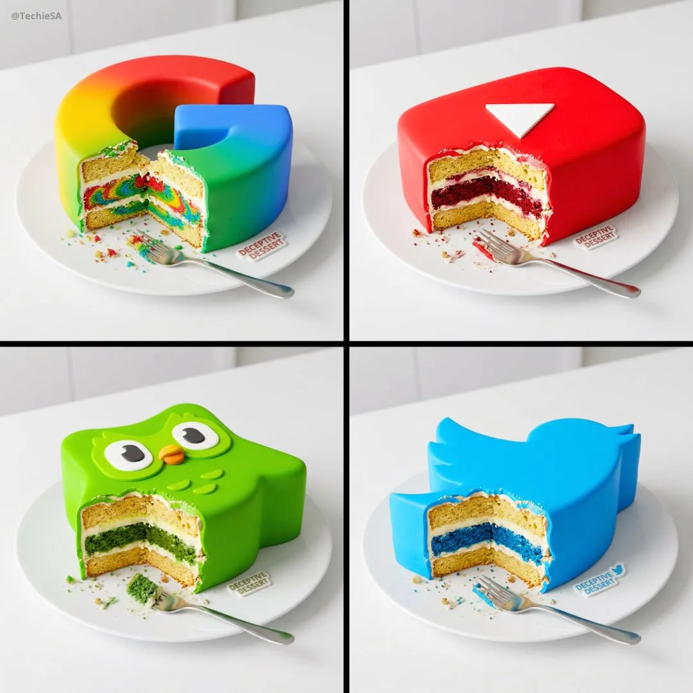

# TechieSA — by @TechieBySA

[← Back to Examples from X](../../EXAMPLES.md) · Category: Illustration & 3D · Model: `Nano Banana`

<a href="https://x.com/TechieBySA/status/2029164036588241196"></a>

Original post: **[@TechieBySA on X](https://x.com/TechieBySA/status/2029164036588241196)** · Creator: [TechieSA](https://x.com/TechieBySA)

## Prompt

```text
Generate a hyper-realistic digital illustration of a cake meticulously stylized to resemble a [LOGO] resting on a pristine white table. Show it partially bitten to reveal multiple delicious layers (sponge, frosting, crumbs) and shatter the illusion. Capture the moment of surprise with intricate details in the bite mark. Use a slightly overhead angle to emphasize the contrast between the realistic outer shell and the cake interior. Illuminate the scene with soft, diffused lighting to enhance textures and cast subtle shadows for depth. Keep the background minimal and bright to focus on the deceptive dessert. Employ a vibrant, playful palette for the cake layers against the object-mimicking exterior. Render in a photorealistic style with whimsical undertones, making the reveal both visually convincing and appetizing.
```

## Try it

Paste the prompt into **[vinano.ai](https://vinano.ai?utm_source=github&utm_medium=readme&utm_campaign=awesome-image-video-prompts-updating&utm_content=x-page-try)** to generate your own version.

> The image and prompt belong to [@TechieBySA](https://x.com/TechieBySA) and are shown here with credit for reference. Creators can ask for changes or removal by opening an issue.
