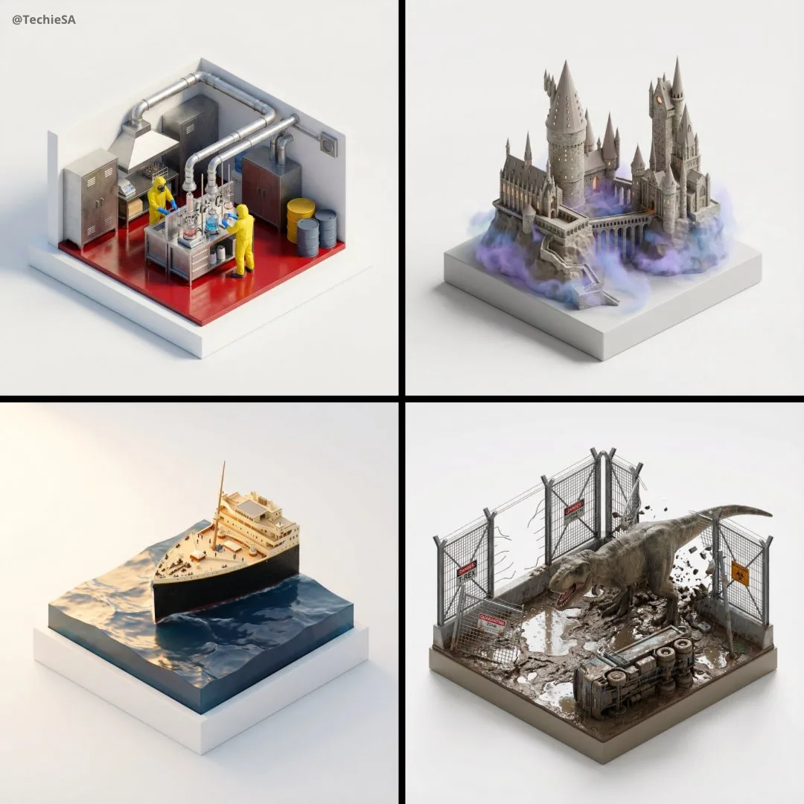

# TechieSA — by @TechieBySA

[← Back to Community Examples](../../EXAMPLES.md) · Category: Illustration & 3D · Model: `Nano Banana`

<a href="https://x.com/TechieBySA/status/2011815709739802811"></a>

Source: **[@TechieBySA on X](https://x.com/TechieBySA/status/2011815709739802811)** · Creator: [TechieSA](https://x.com/TechieBySA)

## Prompt

```text
Stylized, ultra high-fidelity 3D isometric miniature diorama, 35–40° isometric view, palm-sized collectible scale, ultra-clean geometry with realistic micro-detail, soft studio lighting from top-left, gentle ambient occlusion, subtle soft shadows, neutral color grading, museum-quality product render, displayed on a simple matte rectangular base, seamless all-white background, 1080x1080. [MOVIE SCENE].
```

## Try it

Paste the prompt into **[vinano.ai](https://vinano.ai?utm_source=github&utm_medium=readme&utm_campaign=awesome-image-video-prompts-updating&utm_content=x-page-try)** to generate your own version.

> The image and prompt belong to @TechieBySA ([original post](https://x.com/TechieBySA/status/2011815709739802811)) and are shown here with credit for reference. Creators can ask for changes or removal by opening an issue.
