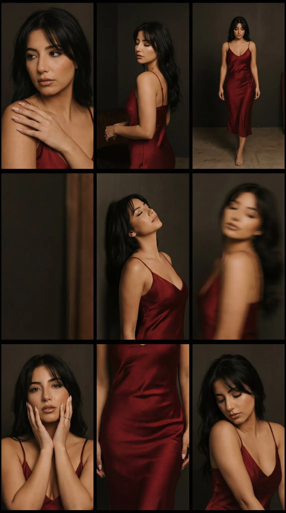

# Özge Döner — by @astronomerozge1

[← Back to Examples from X](../../EXAMPLES.md) · Category: Photography · Model: `Nano Banana`

<a href="https://x.com/astronomerozge1/status/2010410887257923690"></a>

Original post: **[@astronomerozge1 on X](https://x.com/astronomerozge1/status/2010410887257923690)** · Creator: [Özge Döner](https://x.com/astronomerozge1)

## Prompt

```text
{
  "generation_request": {
    "meta_data": {
      "tool": "NanoBanana Pro",
      "task_type": "photoreal_cinematic_fashion_contact_sheet",
      "version": "v1.0_RED_DRESS_INTIMATE_EDITORIAL_3x3_NO_TEXT",
      "priority": "highest"
    },

    "references": {
      "reference_image_1": {
        "source": "UPLOAD_REFERENCE_IMAGE (OPTIONAL)",
        "purpose": "FACE_IDENTITY_LOCK",
        "strict_lock": true,
        "face_similarity_priority": "MAX",
        "no_identity_blending": true,
        "no_beautify": true,
        "preserve_skin_texture": true,
        "preserve_facial_proportions": true
      }
    },

    "output_settings": {
      "aspect_ratio": "1:1",
      "resolution_target": "ultra_high_res",
      "render_style": "cinematic_fashion_editorial",
      "sharpness": "soft_cinematic_focus",
      "film_grain": "subtle_analog_35mm",
      "dynamic_range": "natural_not_hdr",
      "color_grade": "muted_warm_reds_dark_neutrals",
      "skin_rendering": "real_skin_microtexture_no_plastic"
    },

    "layout": {
      "type": "contact_sheet",
      "grid": "3x3",
      "spacing": "thin_clean_dividers",
      "panel_consistency": "same_subject_same_outfit_same_scene",
      "no_text_overlay": true
    },

    "camera": {
      "camera_type": "full_frame_cinema_camera",
      "lens": "50mm_and_85mm_mix",
      "aperture": "f1.8",
      "depth_of_field": "shallow",
      "focus_behavior": "eyes_priority_some_frames_soft_motion",
      "processing": "no_ai_sharpening_no_hdr"
    },

    "lighting": {
      "type": "low_key_cinematic_indoor_light",
      "source": "window_light_side_falloff",
      "contrast": "medium_to_low",
      "shadows": "soft_deep",
      "highlights": "controlled_skin_specular"
    },

    "wardrobe_and_styling": {
      "dress": "deep_red_silk_satin_slip_dress",
      "fabric_behavior": "fluid_realistic_drape_soft_specular",
      "straps": "thin_delicate",
      "overall_style": "intimate_high_fashion_editorial"
    },

    "hair_and_makeup": {
      "hair": "natural_loose_with_soft_bangs",
      "movement": "subtle_natural_motion",
      "makeup_style": "soft_editorial",
      "eyes": "natural_smoky_low_contrast",
      "lips": "muted_rose_nude",
      "skin_finish": "natural_luminous_real"
    },

    "posing_and_storytelling": {
      "poses": [
        "close_up_shoulder_touch",
        "mid_body_turning_away",
        "full_body_walking_away",
        "leaning_against_wall",
        "head_tilted_back_emotional",
        "eyes_closed_intimate",
        "soft_motion_blur_moment",
        "hands_touching_face",
        "dress_detail_closeup"
      ],
      "emotion": "introspective_sensual_vulnerable",
      "movement": "slow_natural_unposed"
    },

    "background": {
      "environment": "dark_interior_gallery_or_room",
      "colors": [
        "deep_red",
        "charcoal_gray",
        "dark_green"
      ],
      "texture": "matte_walls_soft_reflections",
      "distractions": "none"
    },

    "creative_prompt": {
      "scene_summary": "A cinematic 3x3 fashion contact sheet capturing an intimate, emotional editorial story of a woman in a deep red satin dress. Each frame feels like a quiet moment from an arthouse film — soft focus, natural movement, emotional restraint, and sensual minimalism.",
      "aesthetic": "arthouse_fashion_editorial",
      "mood": "quiet_intimate_cinematic"
    },

    "negative_prompt": [
      "text",
      "typography",
      "logo",
      "brand_name",
      "watermark",
      "poster_design",
      "magazine_layout",
      "beauty_filter",
      "plastic_skin",
      "over_smoothing",
      "cgi",
      "anime",
      "cartoon",
      "ai_artifacts",
      "extra_people",
      "distorted_body",
      "bad_hands",
      "extra_fingers",
      "over_sharpened"
    ]
  }
}
```

## Try it

Paste the prompt into **[vinano.ai](https://vinano.ai?utm_source=github&utm_medium=readme&utm_campaign=awesome-image-video-prompts-updating&utm_content=x-page-try)** to generate your own version.

> The image and prompt belong to [@astronomerozge1](https://x.com/astronomerozge1) and are shown here with credit for reference. Creators can ask for changes or removal by opening an issue.
