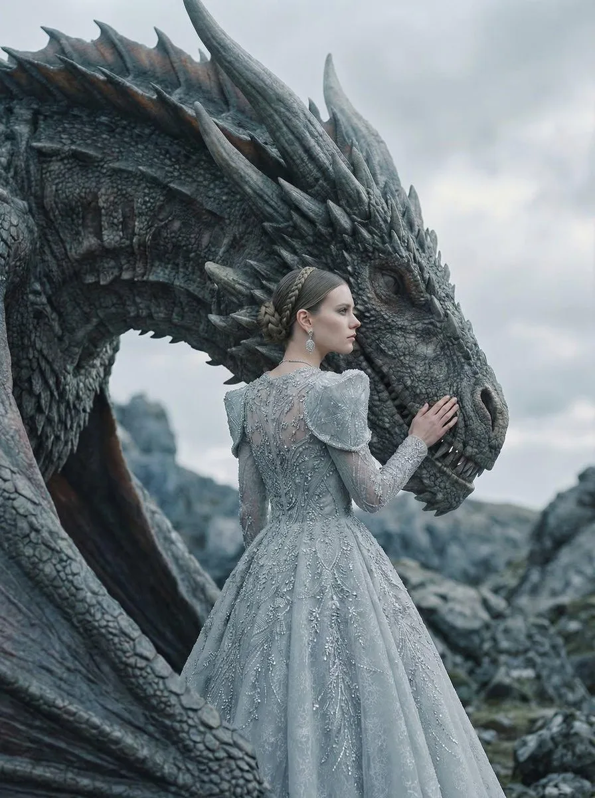

# K — by @ChillaiKalan__

[← Back to Community Examples](../../EXAMPLES.md) · Category: Photography · Model: `Nano Banana`

<a href="https://x.com/ChillaiKalan__/status/2013495788824117576"></a>

Source: **[@ChillaiKalan__ on X](https://x.com/ChillaiKalan__/status/2013495788824117576)** · Creator: [K](https://x.com/ChillaiKalan__)

## Prompt

```text
Luxury fashion editorial portrait of a woman standing beside a majestic dragon, her forehead gently resting against its scaled head. She wears an elaborate ice-gray couture gown with intricate embroidery, crystal embellishments, and structured shoulders, evoking regal power and quiet intimacy. Hair styled in a sleek braided updo, adorned with refined statement jewelry. Cinematic fantasy realism, emotional stillness, mythic elegance. Cold, muted color palette of silver, stone, and ash tones. Soft natural overcast light, subtle highlights on textures of fabric and dragon scales. Shallow depth of field, ultra-detailed realism, high-end editorial aesthetic, epic yet intimate mood, medium format photography look, Vogue-level fantasy couture, no text.
```

## Try it

Paste the prompt into **[vinano.ai](https://vinano.ai?utm_source=github&utm_medium=readme&utm_campaign=awesome-image-video-prompts-updating&utm_content=x-page-try)** to generate your own version.

> The image and prompt belong to @ChillaiKalan__ ([original post](https://x.com/ChillaiKalan__/status/2013495788824117576)) and are shown here with credit for reference. Creators can ask for changes or removal by opening an issue.
