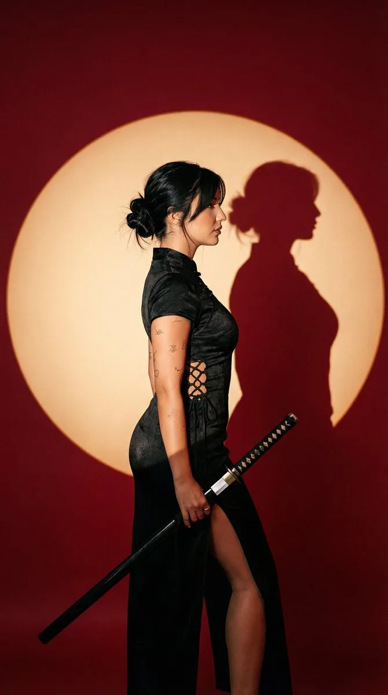

# Özge Döner — by @astronomerozge1

[← Back to Community Examples](../../EXAMPLES.md) · Category: Photography · Model: `Nano Banana`

<a href="https://x.com/astronomerozge1/status/2021291111633858589"></a>

Source: **[@astronomerozge1 on X](https://x.com/astronomerozge1/status/2021291111633858589)** · Creator: [Özge Döner](https://x.com/astronomerozge1)

## Prompt

```text
{
  "generation_request": {
    "meta_data": {
      "task_type": "photoreal_editorial_spotlight_disk_fashion_portrait",
      "language": "en",
      "priority": "highest",
      "version": "v1.0_RED_BACKDROP_CIRCLE_SPOTLIGHT_KATANA_EDITORIAL"
    },
    "output": {
      "aspect_ratio": "4:5",
      "resolution": "high",
      "num_images": 4
    },
    "scene": {
      "concept": "minimal graphic studio portrait with a circular spotlight disk and crisp shadow silhouette",
      "environment": "deep red seamless background, no props, no clutter",
      "composition": "3/4 body or full-body, side profile; subject placed slightly right of center; large circular spotlight disk behind subject"
    },
    "subject": {
      "person": "adult woman",
      "wardrobe": {
        "dress": "fitted black cheongsam-inspired dress, high slit, lace-up side detailing, matte fabric with subtle texture"
      },
      "hair_makeup": {
        "hair": "messy low bun, a few loose strands framing face",
        "makeup": "soft glam, defined eyeliner, natural lips, realistic skin texture"
      },
      "details": {
        "tattoos": "subtle small tattoos on upper arm, realistic ink"
      },
      "pose": "side profile stance, shoulders relaxed, one hand resting near hip, holding a katana angled downward in a safe, non-aggressive pose",
      "expression": "calm, composed, editorial"
    },
    "props": {
      "katana": {
        "style": "realistic katana with correct proportions, simple handle wrap, subtle metal sheen",
        "handling_notes": "safe grip, blade angled down, no threatening gesture"
      }
    },
    "lighting": {
      "style": "single hard key light + spotlight gobo/disk",
      "notes": "create a large circular warm spotlight disk (cream/peach) on the red background; crisp hard-edged shadow silhouette of subject visible on the disk; high contrast; minimal fill"
    },
    "camera": {
      "shot": "editorial studio fashion portrait",
      "lens_mm": 50,
      "aperture": 2.8,
      "focus": "sharp on face, dress texture, and sword handle; background smooth",
      "quality_tags": "ultra-detailed, clean edges, subtle film grain"
    },
    "color_grade": {
      "palette": "deep red background + warm cream spotlight disk + neutral skin + black wardrobe",
      "contrast": "high",
      "tone": "cinematic editorial, smooth highlight rolloff"
    },
    "negative_prompt": "text, logo, watermark, frame, border, clutter, softbox lighting, flat lighting, blur, lowres, plastic skin, over-smoothing, extra fingers, deformed hands, incorrect katana geometry, gore, blood, violence"
  }
}
```

## Try it

Paste the prompt into **[vinano.ai](https://vinano.ai?utm_source=github&utm_medium=readme&utm_campaign=awesome-image-video-prompts-updating&utm_content=x-page-try)** to generate your own version.

> The image and prompt belong to @astronomerozge1 ([original post](https://x.com/astronomerozge1/status/2021291111633858589)) and are shown here with credit for reference. Creators can ask for changes or removal by opening an issue.
