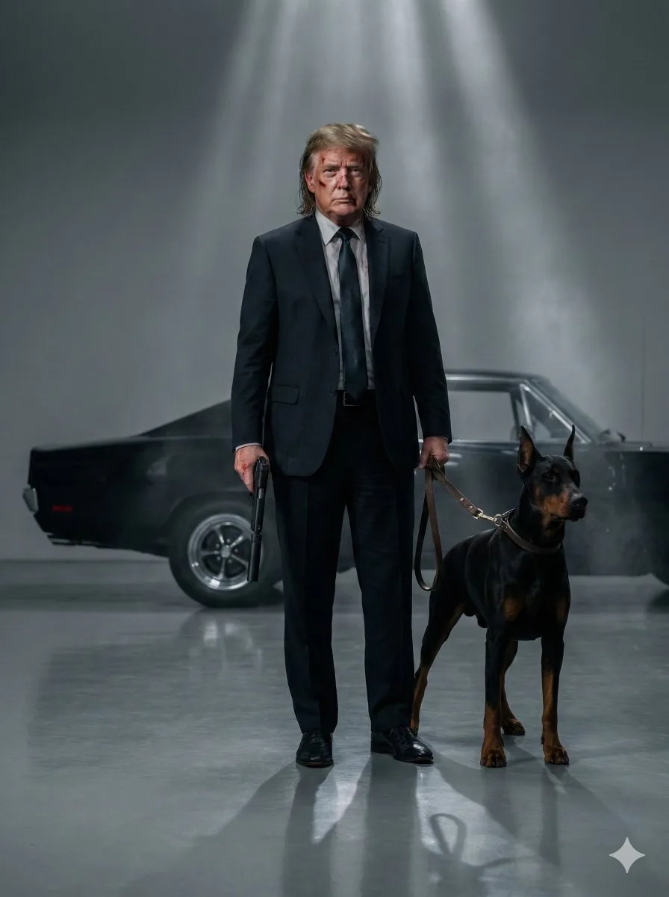

# Heisenberg — by @rovvmut_

[← Back to Community Examples](../../EXAMPLES.md) · Category: Photography · Model: `Nano Banana`

<a href="https://x.com/rovvmut_/status/2026162681171075451"></a>

Source: **[@rovvmut_ on X](https://x.com/rovvmut_/status/2026162681171075451)** · Creator: [Heisenberg](https://x.com/rovvmut_)

## Prompt

```text
Full body cinematic shot of the person in the uploaded image as a hitman in a tailored black suit and tie standing in an empty studio space beside a muscular Doberman dog on a leash. The man has a bruised face with blood marks, messy shoulder-length hair, and a calm but intense expression. He is holding a pistol in one hand. Behind them is a vintage black muscle car with chrome rims partially visible in soft shadow. Minimalist grey background, dramatic studio lighting from above creating soft reflections on the glossy floor. Ultra realistic skin texture, cinematic depth of field, sharp focus, subtle fog in the background, moody atmosphere, 85mm lens look, volumetric light, film still from a neo-noir action movie, high dynamic range, photorealistic, 8k, symmetrical composition. 3:4 aspect ratio.
```

## Try it

Paste the prompt into **[vinano.ai](https://vinano.ai?utm_source=github&utm_medium=readme&utm_campaign=awesome-image-video-prompts-updating&utm_content=x-page-try)** to generate your own version.

> The image and prompt belong to @rovvmut_ ([original post](https://x.com/rovvmut_/status/2026162681171075451)) and are shown here with credit for reference. Creators can ask for changes or removal by opening an issue.
