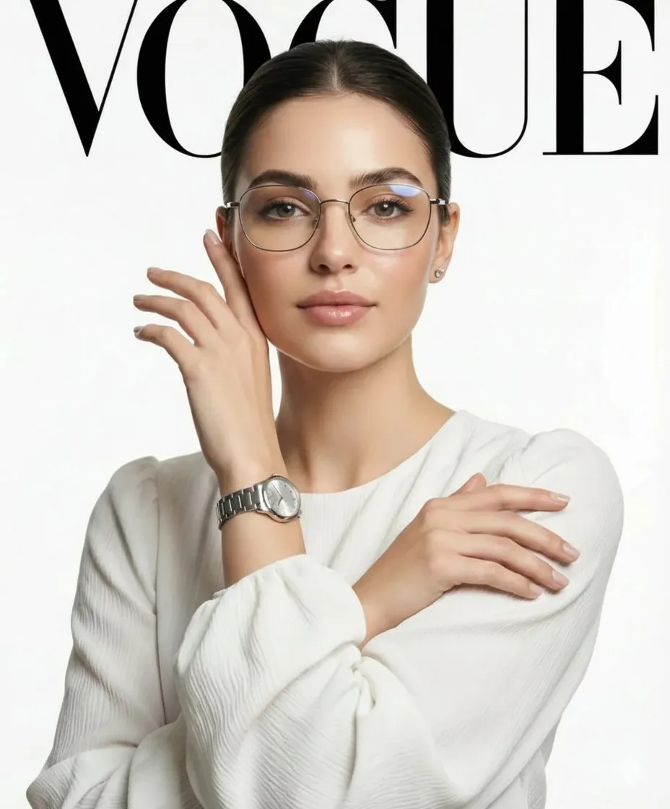

# Aijaz — by @iamsofiaijaz

[← Back to Community Examples](../../EXAMPLES.md) · Category: Poster Design · Model: `Nano Banana`

<a href="https://x.com/iamsofiaijaz/status/2017483949271085191"></a>

Source: **[@iamsofiaijaz on X](https://x.com/iamsofiaijaz/status/2017483949271085191)** · Creator: [Aijaz](https://x.com/iamsofiaijaz)

## Prompt

```text
A high-definition, professional fashion editorial photograph of a sophisticated woman with a sleek, center-parted bun. She is wearing elegant, thin-rimmed silver glasses and a minimalist white long-sleeved silk blouse. She is posed gracefully with her hands near her face and chest, showcasing a luxury silver watch. The background is a clean, bright white with bold, high-contrast black serif typography reading 'VOGUE' at the top. Studio lighting, soft skin texture, sharp focus on the eyes, 8k resolution, shot on a 85mm lens for a flattering portrait compression."
​Tips for Customizing the Result:
​The Model: If you want a different look, change "sophisticated woman" to specific features like "freckles," "dark curly hair," or "minimalist makeup."
​The Brand: You can swap "VOGUE" for any other magazine title or leave it blank for a clean fashion portrait.
​The Jewelry: Adjust the metal (e.g., "gold watch," "rose gold frames") to change the color palette of the image.
```

## Try it

Paste the prompt into **[vinano.ai](https://vinano.ai?utm_source=github&utm_medium=readme&utm_campaign=awesome-image-video-prompts-updating&utm_content=x-page-try)** to generate your own version.

> The image and prompt belong to @iamsofiaijaz ([original post](https://x.com/iamsofiaijaz/status/2017483949271085191)) and are shown here with credit for reference. Creators can ask for changes or removal by opening an issue.
