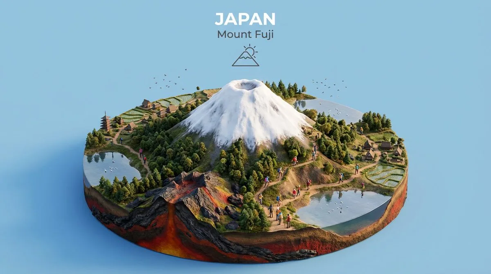

# Aleena Amir — by @aleenaamiir

[← Back to Community Examples](../../EXAMPLES.md) · Category: Illustration & 3D · Model: `Nano Banana`

<a href="https://x.com/aleenaamiir/status/2019267462647439770"></a>

Source: **[@aleenaamiir on X](https://x.com/aleenaamiir/status/2019267462647439770)** · Creator: [Aleena Amir](https://x.com/aleenaamiir)

## Prompt

```text
Create an isometric miniature 3D diorama highlighting the natural landmark [NATURAL WONDER] from [COUNTRY NAME/PLANET].

Use a 40–45° top-down view. Textures look organic and realistic with PBR materials. Lighting feels soft and atmospheric.

The raised base shows terrain layers, vegetation, and surrounding geography. Add tiny stylized explorers or wildlife with no facial details.

Background remains solid [BACKGROUND COLOR].

Top center text displays [COUNTRY NAME] in bold.
Second line shows [NATURAL WONDER]. Place a minimal nature icon below. Text automatically adapts for contrast.
```

## Try it

Paste the prompt into **[vinano.ai](https://vinano.ai?utm_source=github&utm_medium=readme&utm_campaign=awesome-image-video-prompts-updating&utm_content=x-page-try)** to generate your own version.

> The image and prompt belong to @aleenaamiir ([original post](https://x.com/aleenaamiir/status/2019267462647439770)) and are shown here with credit for reference. Creators can ask for changes or removal by opening an issue.
