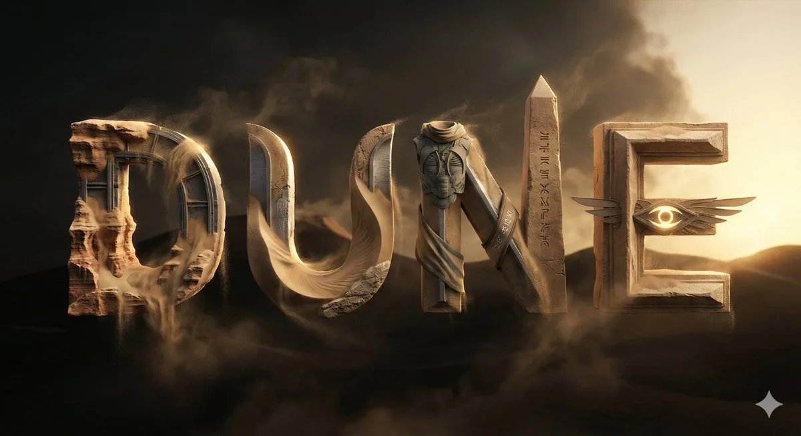

# Aleena Amir — by @aleenaamiir

[← Back to Community Examples](../../EXAMPLES.md) · Category: Illustration & 3D · Model: `Nano Banana`

<a href="https://x.com/aleenaamiir/status/2018966979013644422"></a>

Source: **[@aleenaamiir on X](https://x.com/aleenaamiir/status/2018966979013644422)** · Creator: [Aleena Amir](https://x.com/aleenaamiir)

## Prompt

```text
Create a cinematic 3D typographic composition spelling [WORD / NAME], where each letter is sculpted from the personality, environment, and emotional arc of [CHARACTER / STORY].

Letters are formed using clothing textures, symbolic props, architecture, and lighting motifs tied to different moments of the narrative.

No literal faces — identity is conveyed through silhouettes, posture, materials, and atmosphere. Use premium metallic or stone materials with subtle wear.

Dark cinematic background, dramatic rim lighting, deep shadows, ultra-realistic render, film-title quality.
```

## Try it

Paste the prompt into **[vinano.ai](https://vinano.ai?utm_source=github&utm_medium=readme&utm_campaign=awesome-image-video-prompts-updating&utm_content=x-page-try)** to generate your own version.

> The image and prompt belong to @aleenaamiir ([original post](https://x.com/aleenaamiir/status/2018966979013644422)) and are shown here with credit for reference. Creators can ask for changes or removal by opening an issue.
