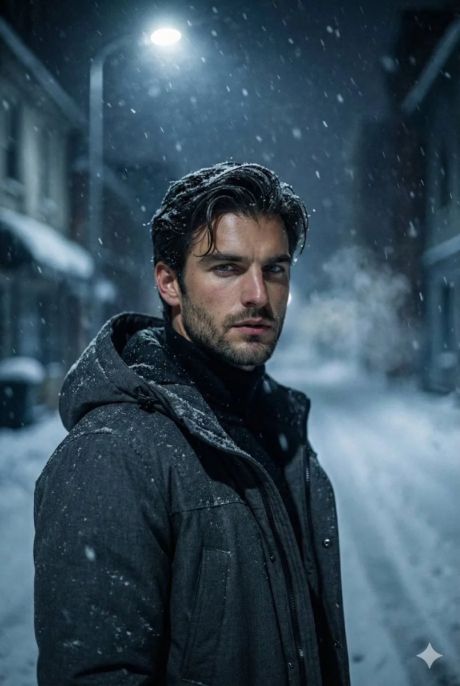

# Snow — by @iamrealsnow

[← Back to Community Examples](../../EXAMPLES.md) · Category: Photography · Model: `Nano Banana`

<a href="https://x.com/iamrealsnow/status/2012135339763101836"></a>

Source: **[@iamrealsnow on X](https://x.com/iamrealsnow/status/2012135339763101836)** · Creator: [Snow](https://x.com/iamrealsnow)

## Prompt

```text
Ultra realistic cinematic portrait of a young man with sharp masculine features and light stubble, snow dusted hair slightly longer and pushed back, calm but intense eyes looking slightly away from the camera, wearing a charcoal hooded winter jacket layered over a black turtleneck, standing in a deserted snowy street at night, heavy snowfall swirling around him, snowflakes catching light mid air, cold breath visible, dim ambient street lighting with a single overhead lamp casting soft shadows, background filled with snow covered buildings and faint fog, low key lighting with cool blue tones, subtle rim light separating the subject from the background, medium close up framing, 50mm lens look, shallow depth of field, cinematic contrast, realistic skin texture, film grain, moody atmosphere, loneliness, quiet strength, winter noir aesthetic, professional photography realism.
```

## Try it

Paste the prompt into **[vinano.ai](https://vinano.ai?utm_source=github&utm_medium=readme&utm_campaign=awesome-image-video-prompts-updating&utm_content=x-page-try)** to generate your own version.

> The image and prompt belong to @iamrealsnow ([original post](https://x.com/iamrealsnow/status/2012135339763101836)) and are shown here with credit for reference. Creators can ask for changes or removal by opening an issue.
