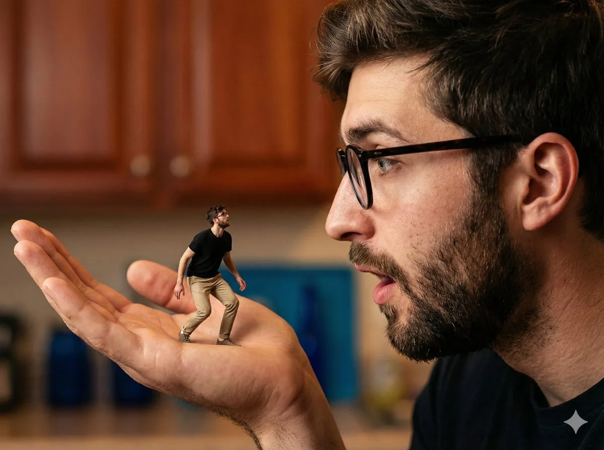

# Duet | AI — by @Sheldon056

[← Back to Examples from X](../../EXAMPLES.md) · Category: Photography · Model: `Nano Banana`

<a href="https://x.com/Sheldon056/status/2011035560593309925"></a>

Original post: **[@Sheldon056 on X](https://x.com/Sheldon056/status/2011035560593309925)** · Creator: [Duet | AI](https://x.com/Sheldon056)

## Prompt

```text
A hyper-realistic, surreal composite shot utilizing forced perspective to create a dramatic scale difference, featuring an extreme close-up profile view on the right side of a man with uploaded face as reference, his expression one of slack-jawed astonishment with mouth slightly agape as he gazes downward. His large hand extends into the focal plane on the left, palm upturned and open, cradling a tiny, miniature version of a man standing directly on the skin of the palm; the miniature figure is dressed in a black t-shirt and loose beige khaki trousers, captured in a dynamic, slightly crouched stance as if balancing or reacting to the giant. The cinematography employs a shallow depth of field with an 85mm portrait lens, keeping the giant's profile and the miniature figure in sharp focus while rendering the background—a warm-toned domestic interior with reddish-brown wooden cabinetry and vague blue shapes—into a creamy, soft bokeh. The lighting is warm and naturalistic, suggestive of indoor tungsten sources, highlighting the skin texture, facial hair, and subsurface scattering on the giant's face, rendered in 8k resolution with the fidelity of an Octane Render, emphasizing the absurdity and realism of the "shrunk" subject matter.

Man should be fully visible
```

## Try it

Paste the prompt into **[vinano.ai](https://vinano.ai?utm_source=github&utm_medium=readme&utm_campaign=awesome-image-video-prompts-updating&utm_content=x-page-try)** to generate your own version.

> The image and prompt belong to [@Sheldon056](https://x.com/Sheldon056) and are shown here with credit for reference. Creators can ask for changes or removal by opening an issue.
