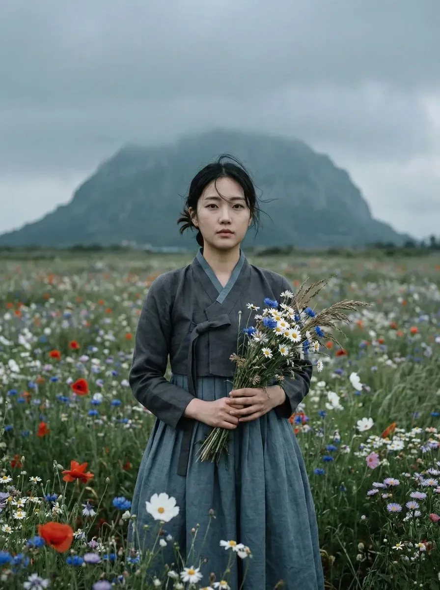

# Oogie — by @oggii_0

[← Back to Community Examples](../../EXAMPLES.md) · Category: Photography · Model: `Nano Banana`

<a href="https://x.com/oggii_0/status/2019094555501686847"></a>

Source: **[@oggii_0 on X](https://x.com/oggii_0/status/2019094555501686847)** · Creator: [Oogie](https://x.com/oggii_0)

## Prompt

```text
Ultra-realistic cinematic portrait of a young East Asian woman standing alone in a vast wildflower meadow. She is centered in the frame, facing the camera directly with a calm, introspective expression. She wears a traditional Korean hanbok in muted charcoal gray and soft blue tones, with natural fabric texture and subtle folds. Her dark hair is loosely tied back with a few strands gently blown across her face by the wind.

She holds a small hand-picked bouquet of wildflowers—white daisies, blue cornflowers, and dry grass stems—clasped softly in both hands at waist level. The meadow is filled with colorful wildflowers (reds, whites, blues, purples) stretching into the distance.

In the background, a large mist-covered mountain rises softly out of focus, partially obscured by low clouds and fog, creating a moody, atmospheric depth. Overcast sky with soft diffused natural light, cool color palette, muted contrast, cinematic realism.

Shallow depth of field, sharp focus on subject, creamy background bokeh. Natural skin texture, realistic facial details, no makeup look. Fine art photography style, emotional, poetic, timeless. Shot on a full-frame camera, 85mm lens, f/1.8, ultra-high resolution, photorealistic, no text, no watermark.
```

## Try it

Paste the prompt into **[vinano.ai](https://vinano.ai?utm_source=github&utm_medium=readme&utm_campaign=awesome-image-video-prompts-updating&utm_content=x-page-try)** to generate your own version.

> The image and prompt belong to @oggii_0 ([original post](https://x.com/oggii_0/status/2019094555501686847)) and are shown here with credit for reference. Creators can ask for changes or removal by opening an issue.
