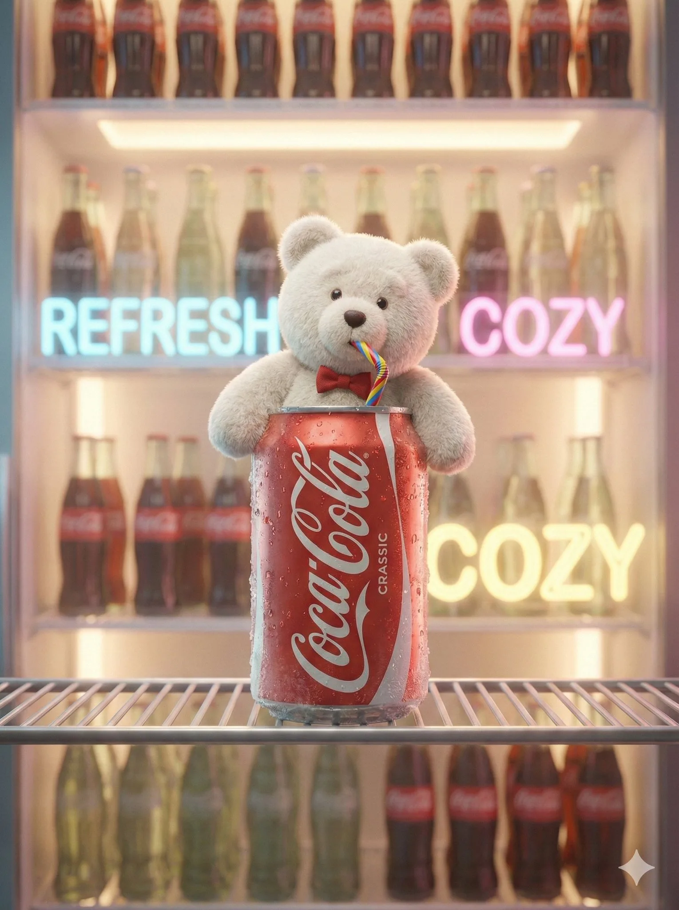

# 𝐌 — by @Strength04_X

[← Back to Examples from X](../../EXAMPLES.md) · Category: Illustration & 3D · Model: `Nano Banana`

<a href="https://x.com/Strength04_X/status/2008912370551357865"></a>

Original post: **[@Strength04_X on X](https://x.com/Strength04_X/status/2008912370551357865)** · Creator: [𝐌](https://x.com/Strength04_X)

## Prompt

```text
A cute, cinematic brand fantasy scene featuring a fluffy white teddy bear mascot emerging from a chilled soda Coca-Cola can, holding a colorful striped straw.

The can is placed inside a glowing refrigerator filled with neatly stacked glass soda bottles. Soft neon lighting, pastel reflections, condensation droplets on metal, playful yet premium advertising style. Shallow depth of field, ultra-detailed fur texture, glossy highlights, vibrant red-and-white color pal-ette, whimsical mood, Pixar-level realism, stu-dio-quality lighting, high contrast, square composi-tion, 1080×1080, ultra-HD, commercial brand photog-raphy.
```

## Try it

Paste the prompt into **[vinano.ai](https://vinano.ai?utm_source=github&utm_medium=readme&utm_campaign=awesome-image-video-prompts-updating&utm_content=x-page-try)** to generate your own version.

> The image and prompt belong to [@Strength04_X](https://x.com/Strength04_X) and are shown here with credit for reference. Creators can ask for changes or removal by opening an issue.
