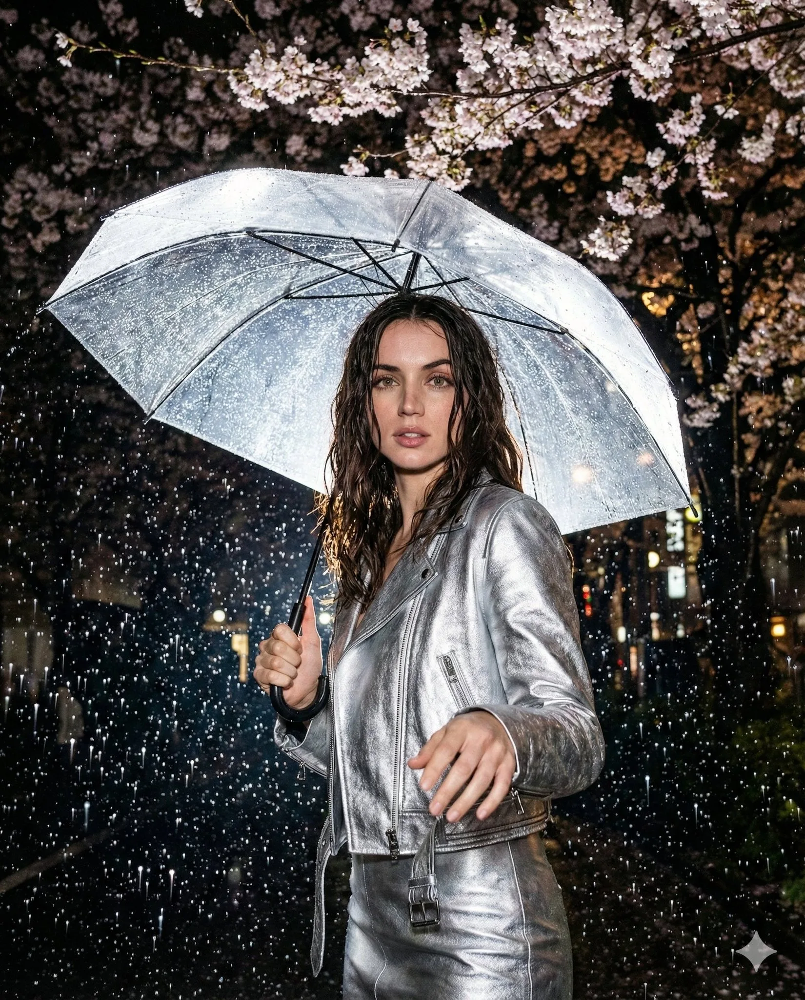

# Sudee🥀 — by @NameIsSudee

[← Back to Examples from X](../../EXAMPLES.md) · Category: Photography · Model: `Nano Banana`

<a href="https://x.com/NameIsSudee/status/2009236662149316854"></a>

Original post: **[@NameIsSudee on X](https://x.com/NameIsSudee/status/2009236662149316854)** · Creator: [Sudee🥀](https://x.com/NameIsSudee)

## Prompt

```text
{
  "prompt": "High-resolution nighttime editorial portrait shot with on-camera flash. A young woman standing outdoors at night under blooming cherry blossom trees, holding a transparent clear umbrella covered in raindrops. Her hair is wet and slightly wavy, framing her face naturally. She wears a brown leather jacket with a matching skirt, styled minimal and modern. One hand reaches slightly toward the camera, creating depth and intimacy. Strong flash lighting with a dark background, rain droplets frozen in motion, cinematic contrast, shallow depth of field, fashion editorial vibe, realistic skin tones, sharp focus. No text, no watermark.",
  "style": "fashion editorial, cinematic, modern",
  "camera": {
    "shot_type": "portrait",
    "lighting": "on-camera flash",
    "depth_of_field": "shallow"
  },
  "lighting": {
    "type": "strong flash",
    "environment": "nighttime",
    "effect": ["high contrast", "frozen raindrops"]
  },
  "environment": {
    "location": "outdoor nighttime setting",
    "elements": ["cherry blossom trees", "rain", "dark background"]
  },
  "wardrobe": {
    "outfit": ["Silver leather jacket", "matching skirt"],
    "style": "minimal, modern"
  },
  "mood": ["intimate", "cinematic", "editorial"],
  "quality": ["high-resolution", "sharp focus", "realistic skin tones"],
  "constraints": ["no text", "no watermark"]
}
```

## Try it

Paste the prompt into **[vinano.ai](https://vinano.ai?utm_source=github&utm_medium=readme&utm_campaign=awesome-image-video-prompts-updating&utm_content=x-page-try)** to generate your own version.

> The image and prompt belong to [@NameIsSudee](https://x.com/NameIsSudee) and are shown here with credit for reference. Creators can ask for changes or removal by opening an issue.
