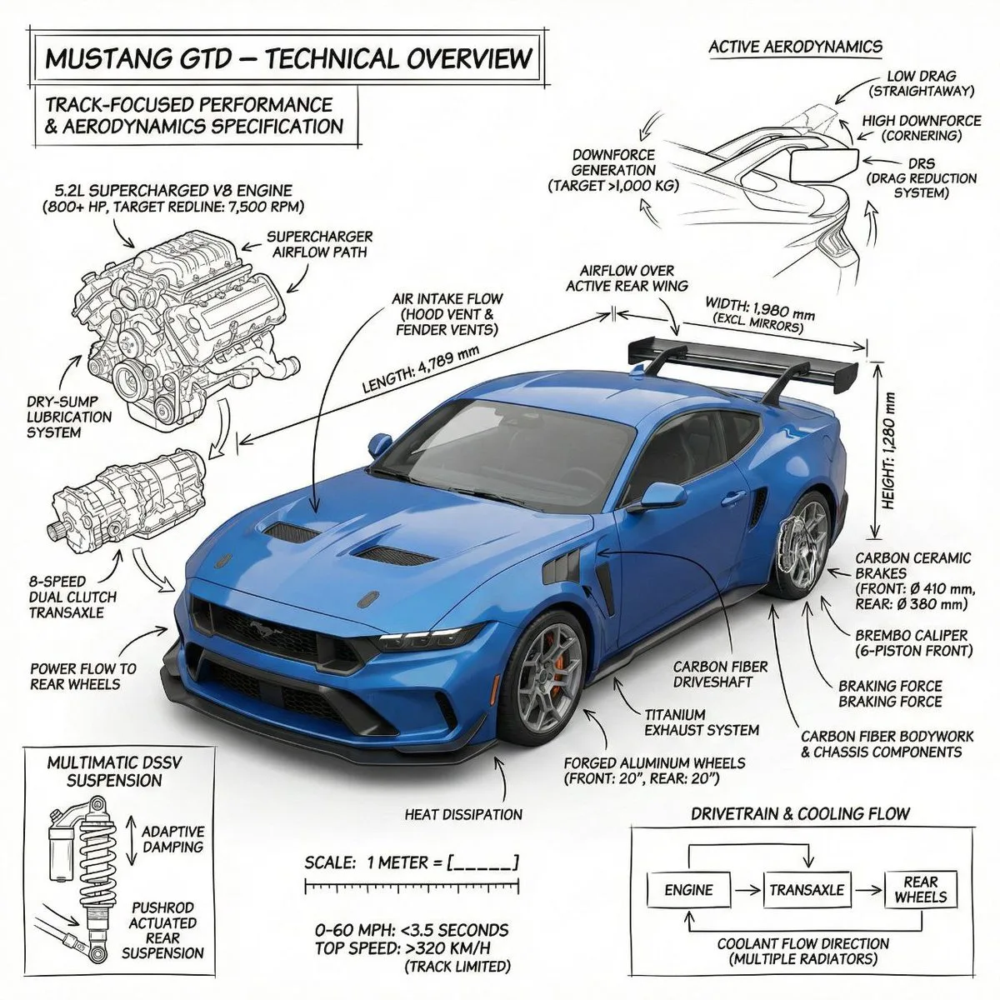

# 𝐌 — by @Strength04_X

[← Back to Community Examples](../../EXAMPLES.md) · Category: Illustration & 3D · Model: `Nano Banana`

<a href="https://x.com/Strength04_X/status/2018276369353015519"></a>

Source: **[@Strength04_X on X](https://x.com/Strength04_X/status/2018276369353015519)** · Creator: [𝐌](https://x.com/Strength04_X)

## Prompt

```text
Create an infographic image of Mustang GTD  combining a realistic photograph or photorealistic render of the object with technical annotation overlays placed directly on top.

Use black ink–style line drawings and text (blue Mustang GTD   ) on a pure white studio background.

Include:
•Key component labels
•Internal cutaway or exploded-view outlines (where relevant)
•Measurements, dimensions, and scale markers
•Material callouts and quantities
•Arrows indicating function, force, or flow (all the functions that comes with bugatti Chiron)
•Simple schematic or sectional diagrams where applicable

Place the title Mustang GTD  inside a real technical annotation box in one corner.

Style & layout rules:
•The real object remains clearly visible beneath the annotations(no annotation on the real object)
•Annotations look hand-sketched, technical, and architectural
•Clean composition with balanced negative space
•Educational, museum-exhibit / engineering-manual vibe

Visual style:
Minimal technical illustration aesthetic.
Black linework layered over realistic imagery.
Precise but slightly hand-drawn feel.

Color palette:
Pure white background.
Black annotation lines and text only.
No colors.

Output:
1080 × 1080 resolution
Ultra-crisp
Social-feed optimized
No watermark
```

## Try it

Paste the prompt into **[vinano.ai](https://vinano.ai?utm_source=github&utm_medium=readme&utm_campaign=awesome-image-video-prompts-updating&utm_content=x-page-try)** to generate your own version.

> The image and prompt belong to @Strength04_X ([original post](https://x.com/Strength04_X/status/2018276369353015519)) and are shown here with credit for reference. Creators can ask for changes or removal by opening an issue.
