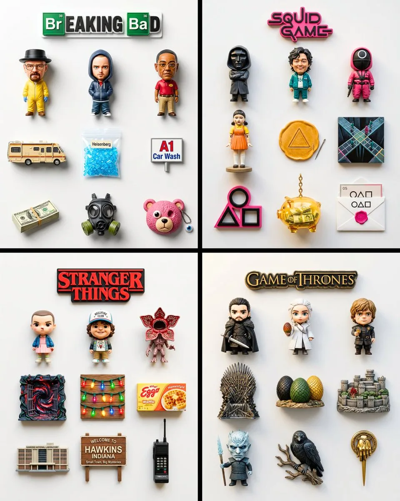

# TechieSA — by @TechieBySA

[← Back to Examples from X](../../EXAMPLES.md) · Category: Illustration & 3D · Model: `Nano Banana`

<a href="https://x.com/TechieBySA/status/2040134478203416799"></a>

Original post: **[@TechieBySA on X](https://x.com/TechieBySA/status/2040134478203416799)** · Creator: [TechieSA](https://x.com/TechieBySA)

## Prompt

```text
A flat-lay collection of exactly 9 hyper-realistic 3D resin fridge magnets arranged on a plain matte white surface, themed around [COUNTRY]. At the very top center, a wide rectangular text magnet spells "COUNTRY" in bold 3D block letters colored in the nation's flag colors. Below it, 8 magnets are arranged in a loose 3-column grid: 3 iconic architectural landmarks as highly detailed sculpted miniature reliefs (cathedrals, towers, castles, monuments), 1 famous painting or portrait reproduced inside a gold ornate picture frame magnet, 1 traditional food dish and 1 drink (wine bottle + glass, or beer stein, etc.) as glossy ceramic sculpted magnets, 1 illustrated vintage-style map magnet of the country with city markers, and 1 additional cultural symbol or landmark. Each magnet has a slightly raised 3D sculpted look with soft drop shadows on the white surface beneath. Warm studio lighting from above, photorealistic product render, perfectly clean white background, top-down flat-lay angle, 4:5 aspect ratio.
```

## Try it

Paste the prompt into **[vinano.ai](https://vinano.ai?utm_source=github&utm_medium=readme&utm_campaign=awesome-image-video-prompts-updating&utm_content=x-page-try)** to generate your own version.

> The image and prompt belong to [@TechieBySA](https://x.com/TechieBySA) and are shown here with credit for reference. Creators can ask for changes or removal by opening an issue.
