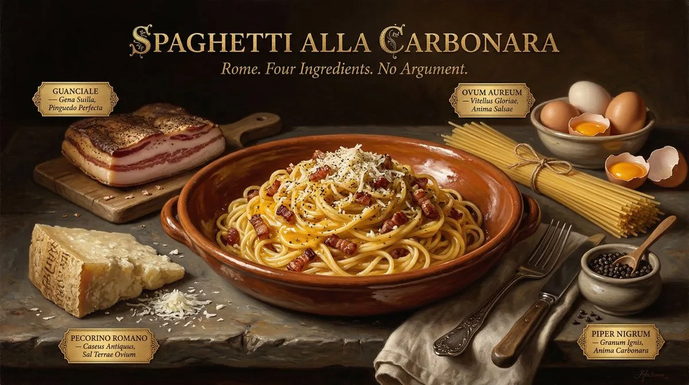

# Alexandra Aisling — by @AllaAisling

[← Back to Examples from X](../../EXAMPLES.md) · Category: Food & Drink · Model: `Nano Banana`

<a href="https://x.com/AllaAisling/status/2035111136958587304"></a>

Original post: **[@AllaAisling on X](https://x.com/AllaAisling/status/2035111136958587304)** · Creator: [Alexandra Aisling](https://x.com/AllaAisling)

## Prompt

```text
[DISH] painted in the style of a Dutch Golden Age or Italian Renaissance still life, hyperrealistic oil painting aesthetic with dramatic chiaroscuro lighting. Hero dish at center on a dark velvet or stone surface, surrounded by its ingredients arranged in a baroque composition. Single dramatic light source from upper left illuminating every texture with painterly depth: glistening proteins, translucent sauces, jewel-bright vegetables, crusty bread, scattered herbs. Each ingredient labeled with a small elegant gold cartouche, ornate bordered label in copperplate: "[INGREDIENT]  [poetic Latin or French descriptor]". Dish name in ornate gilt typography at top: "[DISH NAME]". Subtitle: "[TAGLINE]". Mood: Caravaggio meets Rembrandt meets the world's most craveable food photograph. Deep rich shadows, jewel-tone colors, extraordinary museum-quality, craveable.
```

## Try it

Paste the prompt into **[vinano.ai](https://vinano.ai?utm_source=github&utm_medium=readme&utm_campaign=awesome-image-video-prompts-updating&utm_content=x-page-try)** to generate your own version.

> The image and prompt belong to [@AllaAisling](https://x.com/AllaAisling) and are shown here with credit for reference. Creators can ask for changes or removal by opening an issue.
