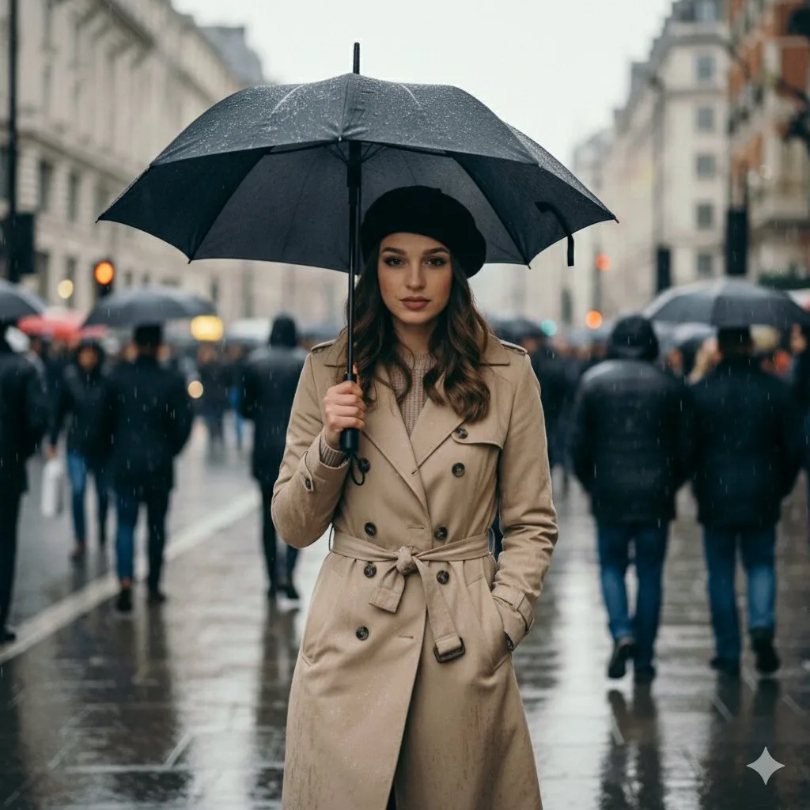

# Johnn — by @john_my07

[← Back to Community Examples](../../EXAMPLES.md) · Category: Photography · Model: `Nano Banana`

<a href="https://x.com/john_my07/status/2009832919603311045"></a>

Source: **[@john_my07 on X](https://x.com/john_my07/status/2009832919603311045)** · Creator: [Johnn](https://x.com/john_my07)

## Prompt

```text
{
  "render_goal": "Ultra-cinematic, hyper-realistic rainy street portrait with shallow depth of field",
  "scene": {
    "location": "busy city street",
    "weather": "steady rain, wet reflective roads, soft mist in the air",
    "time": "overcast daytime",
    "atmosphere": "moody, cinematic, emotionally rich"
  },
  "subject": {
    "identity": "girl identical to the reference",
    "action": "walking forward through a crowded street while holding an umbrella",
    "pose": "natural walking posture, relaxed shoulders",
    "expression": "calm, confident, slightly intense",
    "eye_direction": "looking directly at the camera from a distance",
    "outfit": {
      "style": "elegant, modern, attractive",
      "fit": "well-tailored, flattering silhouette",
      "fabric_behavior": "slightly affected by rain, realistic wet textures"
    }
  },
  "composition": {
    "camera_distance": "medium to long shot",
    "framing": "subject centered with balanced negative space",
    "angle": "eye-level, cinematic street photography",
    "focus": "razor-sharp focus on the girl only",
    "depth_of_field": "extremely shallow"
  },
  "background": {
    "crowd": "dense crowd walking in all directions",
    "motion": "crowd fully blurred with motion blur",
    "detail_level": "faces and bodies indistinguishable",
    "separation": "strong subject-background isolation"
  },
  "lighting": {
    "type": "soft diffused natural light",
    "highlights": "subtle rain highlights and reflections",
    "color_tone": "cool cinematic color grading with slight contrast"
  },
  "visual_style": {
    "look": "cinematic street photography",
    "realism": "ultra-realistic skin, fabric, and rain physics",
    "quality": "8K detail, high dynamic range",
    "post_processing": "film-like contrast, subtle grain, no oversharpening"
  },
  "constraints": {
    "accuracy": "match reference pose, framing, mood, and focus precisely",
    "avoid": [
      "cartoon look",
      "overexposed highlights",
      "extra subjects in focus",
      "stylized or fantasy elements"
    ]
  }
}
```

## Try it

Paste the prompt into **[vinano.ai](https://vinano.ai?utm_source=github&utm_medium=readme&utm_campaign=awesome-image-video-prompts-updating&utm_content=x-page-try)** to generate your own version.

> The image and prompt belong to @john_my07 ([original post](https://x.com/john_my07/status/2009832919603311045)) and are shown here with credit for reference. Creators can ask for changes or removal by opening an issue.
