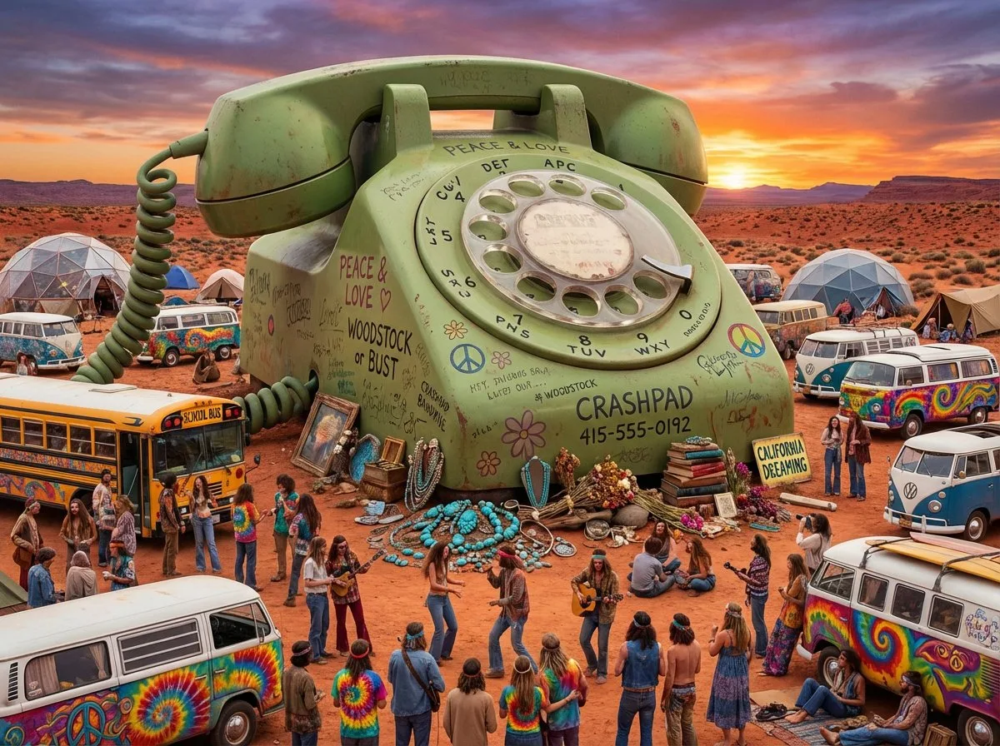

# Alexandra Aisling — by @AllaAisling

[← Back to Community Examples](../../EXAMPLES.md) · Category: Illustration & 3D · Model: `Nano Banana`

<a href="https://x.com/AllaAisling/status/2011484706777546780"></a>

Source: **[@AllaAisling on X](https://x.com/AllaAisling/status/2011484706777546780)** · Creator: [Alexandra Aisling](https://x.com/AllaAisling)

## Prompt

```text
A [ORDINARY OBJECT] as a landmark on an epic journey, tiny [TRAVELERS] resting in its shadow after crossing vast distances visible behind them. Caravans, pack animals, exhausted families. The object marks the halfway point, or the border, or the promised destination. Graffiti and carvings from generations of previous travelers cover its surfaces. Offerings left at its base. Some travelers stay, building permanent settlement. Others push on. Golden hour lighting, dust from the journey still settling, the mundane as waypoint.
```

## Try it

Paste the prompt into **[vinano.ai](https://vinano.ai?utm_source=github&utm_medium=readme&utm_campaign=awesome-image-video-prompts-updating&utm_content=x-page-try)** to generate your own version.

> The image and prompt belong to @AllaAisling ([original post](https://x.com/AllaAisling/status/2011484706777546780)) and are shown here with credit for reference. Creators can ask for changes or removal by opening an issue.
