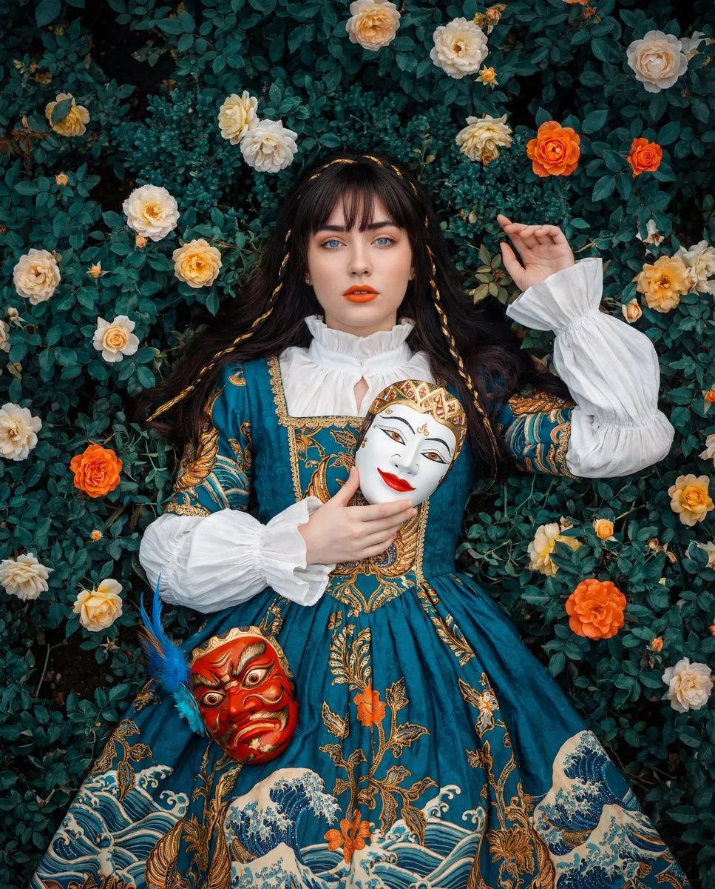

# Zara — by @ZaraIrahh

[← Back to Examples from X](../../EXAMPLES.md) · Category: Photography · Model: `Nano Banana`

<a href="https://x.com/ZaraIrahh/status/2013512902716858758"></a>

Original post: **[@ZaraIrahh on X](https://x.com/ZaraIrahh/status/2013512902716858758)** · Creator: [Zara](https://x.com/ZaraIrahh)

## Prompt

```text
{
  "subject": {
    "hair": {
      "length": "long",
      "color": "dark",
      "style": "flowing, face-framing",
      "bangs": true,
      "accents": {
        "type": "braided",
        "color": "gold"
      }
    },
    "eyes": {
      "color": "light blue",
      "expression": "serene",
      "gaze": "direct"
    },
    "lips": {
      "color": "vibrant orange"
    }
  },

  "attire": {
    "gown": {
      "style": "opulent historical-inspired",
      "main_color": "rich teal-blue",
      "collar": "high ruffled white",
      "sleeves": "voluminous white with gathered cuffs",
      "fabric": {
        "pattern": "Indonesian batik + Ukiyo-e wave motifs",
        "pattern_colors": ["gold", "subtle orange"],
        "detail": "intricate"
      }
    }
  },

  "props": {
    "right_hand_mask": {
      "origin": "Indonesian Javanese wayang-inspired",
      "base_color": "white",
      "lips": "red",
      "expression": "happy",
      "decoration": "gold patterns"
    },
    "left_arm_mask": {
      "origin": "Indonesian traditional",
      "base_color": "red",
      "expression": "angry",
      "decoration": "gold patterns",
      "feather_accent": "blue"
    }
  },

  "pose": {
    "composition": "contrapposto",
    "orientation": "slightly facing left",
    "posture": "lying languidly",
    "framing": "centered"
  },

  "shot": {
    "type": "top-down overhead medium shot",
    "focus": "centered on the woman"
  },

  "background": {
    "foliage": {
      "color": "dark teal-green",
      "density": "dense"
    },
    "flowers": [
      { "type": "rose", "color": "cream" },
      { "type": "rose", "color": "pale yellow" },
      { "type": "rose", "color": "vibrant orange" }
    ]
  },

  "lighting": {
    "type": "soft diffused",
    "highlights": "gentle",
    "shadows": "soft"
  },

  "palette": ["teal", "orange", "cream", "white", "gold"],

  "style": {
    "mood": "rich and luxurious",
    "detail_level": "high",
    "textures": "ornate and rich",
    "cultural_respect": true
  },

  "camera": {
    "angle": "overhead",
    "shot_size": "medium",
    "depth_of_field": "shallow",
    "crop": "centered"
  },

  "output": {
    "format": "image-edit-prompt"
  }
}
```

## Try it

Paste the prompt into **[vinano.ai](https://vinano.ai?utm_source=github&utm_medium=readme&utm_campaign=awesome-image-video-prompts-updating&utm_content=x-page-try)** to generate your own version.

> The image and prompt belong to [@ZaraIrahh](https://x.com/ZaraIrahh) and are shown here with credit for reference. Creators can ask for changes or removal by opening an issue.
