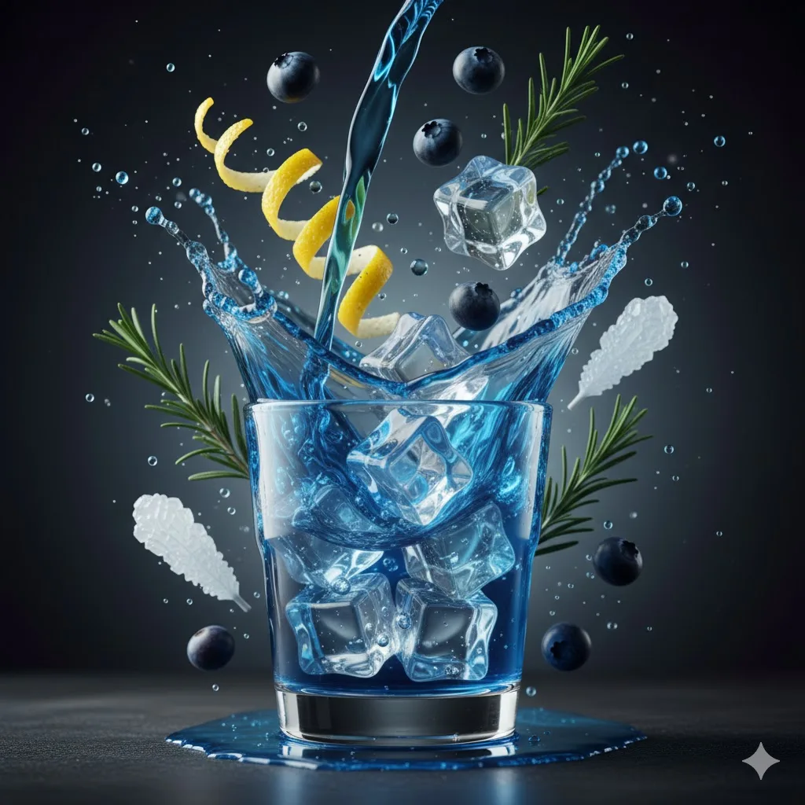

# Cherry 2.O — by @Mind_Boticni

[← Back to Community Examples](../../EXAMPLES.md) · Category: Food & Drink · Model: `Nano Banana`

<a href="https://x.com/Mind_Boticni/status/2019980950067900809"></a>

Source: **[@Mind_Boticni on X](https://x.com/Mind_Boticni/status/2019980950067900809)** · Creator: [Cherry 2.O](https://x.com/Mind_Boticni)

## Prompt

```text
Hyper-realistic food photography, ultra high-definition, dynamic floating ingredients and liquids, ingredients suspended in mid-air, 
motion captured in high-speed freeze, dramatic cinematic studio lighting, dark moody background with subtle gradient, extreme sharpness and fine textures, 
strong contrast highlighting food, splashes, crumbs, sauces, and liquids flying around, central hero composition with ample negative space, 
clean luxury advertising style, no text, no logos, no props, 
realistic shadows and reflections, ultra-detailed, photorealistic, 8K. {image of a cocktail}
```

## Try it

Paste the prompt into **[vinano.ai](https://vinano.ai?utm_source=github&utm_medium=readme&utm_campaign=awesome-image-video-prompts-updating&utm_content=x-page-try)** to generate your own version.

> The image and prompt belong to @Mind_Boticni ([original post](https://x.com/Mind_Boticni/status/2019980950067900809)) and are shown here with credit for reference. Creators can ask for changes or removal by opening an issue.
