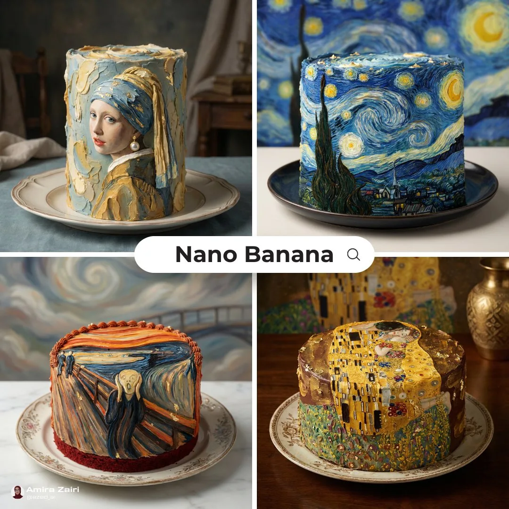

# Amira Zairi — by @azed_ai

[← Back to Community Examples](../../EXAMPLES.md) · Category: Photography · Model: `Nano Banana`

<a href="https://x.com/azed_ai/status/2020950596262691284"></a>

Source: **[@azed_ai on X](https://x.com/azed_ai/status/2020950596262691284)** · Creator: [Amira Zairi](https://x.com/azed_ai)

## Prompt

```text
[cake type], hyper realistic food photography, cake decorated to recreate the famous painting [painting name] using buttercream brushstrokes, thick textured piping, impasto frosting swirls, edible gold leaf highlights, color palette matched to the artwork, small painted fondant details, cake on an elegant plate, background set inspired by the same painting, studio lighting with soft shadows, shallow depth of field, ultra detailed, premium patisserie advertising, no text, no watermark, 8k, 1:1
```

## Try it

Paste the prompt into **[vinano.ai](https://vinano.ai?utm_source=github&utm_medium=readme&utm_campaign=awesome-image-video-prompts-updating&utm_content=x-page-try)** to generate your own version.

> The image and prompt belong to @azed_ai ([original post](https://x.com/azed_ai/status/2020950596262691284)) and are shown here with credit for reference. Creators can ask for changes or removal by opening an issue.
