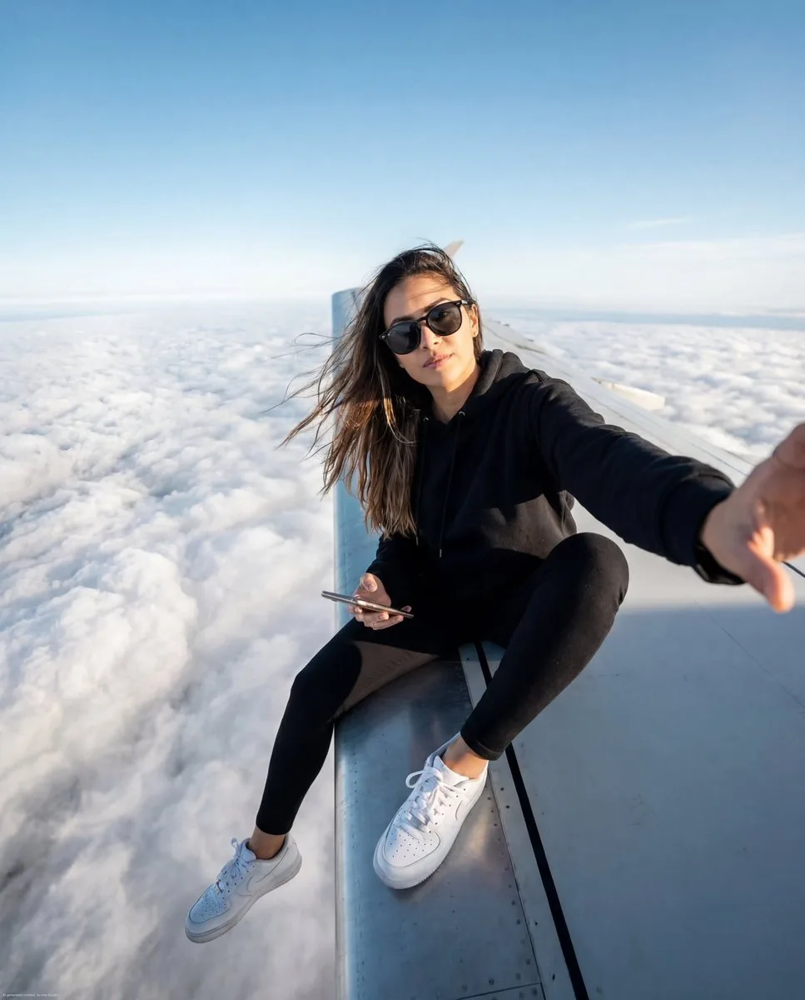

# 𝗦𝗮𝗻𝗶𝗮 — by @saniaspeaks_

[← Back to Community Examples](../../EXAMPLES.md) · Category: Photography · Model: `Nano Banana`

<a href="https://x.com/saniaspeaks_/status/2021553869168550103"></a>

Source: **[@saniaspeaks_ on X](https://x.com/saniaspeaks_/status/2021553869168550103)** · Creator: [𝗦𝗮𝗻𝗶𝗮](https://x.com/saniaspeaks_)

## Prompt

```text
{
  "image_generation": {
    "subject": {
      "description": "stylish young woman sitting on an airplane wing high above the clouds",
      "pose": "seated casually on the airplane wing, one hand extended forward as if taking a selfie, relaxed but confident posture",
      "expression": "calm, confident, composed",
      "gaze": "looking toward the camera with a cool, self-assured expression"
    },
    "appearance": {
      "hair": {
        "style": "long, natural, slightly flowing in the wind",
        "look": "casual and effortless"
      },
      "accessories": [
        "dark sunglasses",
        "minimal jewelry"
      ],
      "vibe": "adventurous, bold, modern"
    },
    "outfit": {
      "style": "sporty casual",
      "details": "black hoodie, black fitted pants, clean white sneakers"
    },
    "environment": {
      "setting": "high above the clouds on an airplane wing",
      "sky": "clear blue sky with soft clouds below",
      "atmosphere": "open, airy, dramatic aerial view"
    },
    "lighting": {
      "type": "natural sunlight",
      "style": "bright and cinematic",
      "direction": "side lighting from the sun",
      "quality": "crisp highlights with soft shadows"
    },
    "camera": {
      "angle": "wide selfie-style perspective from a slightly elevated angle",
      "lens": "ultra wide-angle",
      "depth_of_field": "deep focus capturing both subject and vast sky background",
      "composition": "dynamic, adventurous framing emphasizing height and openness"
    },
    "aesthetic": {
      "style": "cinematic adventure photography",
      "vibe": "bold, fearless, modern, travel lifestyle",
      "color_grading": "clean cinematic tones with natural blues and soft contrast"
    },
    "quality": {
      "realism": "photorealistic",
      "detail": "high detail",
      "resolution": "high resolution",
      "finish": "professional, crisp, ultra-realistic"
    }
  }
}
```

## Try it

Paste the prompt into **[vinano.ai](https://vinano.ai?utm_source=github&utm_medium=readme&utm_campaign=awesome-image-video-prompts-updating&utm_content=x-page-try)** to generate your own version.

> The image and prompt belong to @saniaspeaks_ ([original post](https://x.com/saniaspeaks_/status/2021553869168550103)) and are shown here with credit for reference. Creators can ask for changes or removal by opening an issue.
