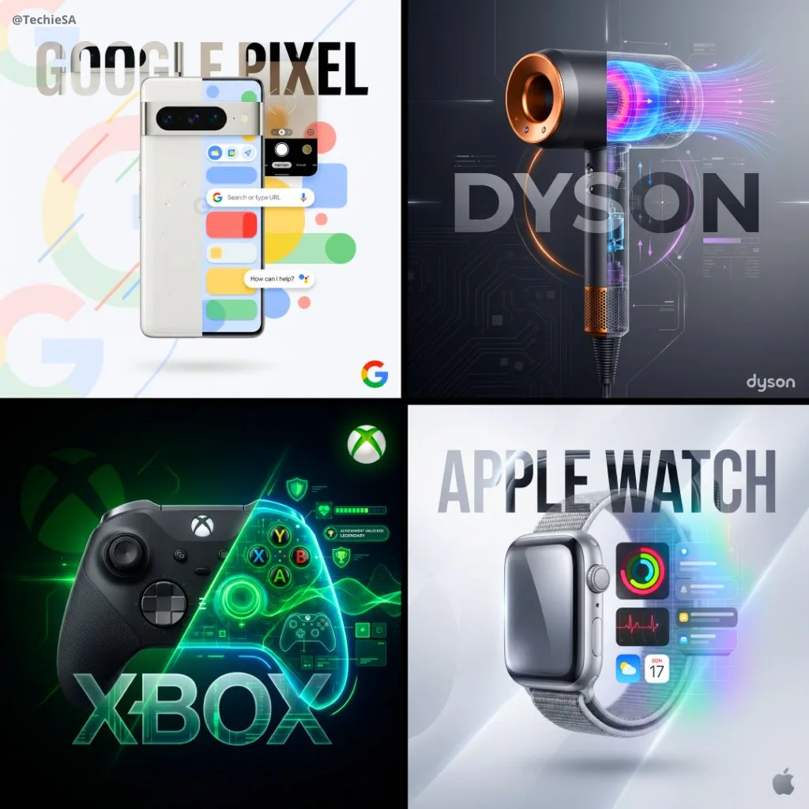

# TechieSA — by @TechieBySA

[← Back to Community Examples](../../EXAMPLES.md) · Category: Product & Brand · Model: `Nano Banana`

<a href="https://x.com/TechieBySA/status/2017188683766538498"></a>

Source: **[@TechieBySA on X](https://x.com/TechieBySA/status/2017188683766538498)** · Creator: [TechieSA](https://x.com/TechieBySA)

## Prompt

```text
Create a 1:1 cinematic product poster (1080×1080) of [BRAND & PRODUCT], centered and fully visible, floating against a clean background inspired by the brand’s core color palette.

The product must remain intact and uncut, but be conceptually split by design:
• One half is photorealistic, showcasing accurate materials, textures, reflections, buttons, surfaces, and premium build quality
• The other half transforms seamlessly into flat digital elements that represent the brand’s ecosystem — UI fragments, abstract tech shapes, interface cards, schematic overlays, soft holographic effects, or minimal glitch-style geometry

Lighting:
Cinematic, high-end studio lighting with controlled highlights and soft shadows, emphasizing form and depth.

Typography:
Bold double-exposure style text displaying the product or brand name, integrated cleanly into the composition.
Official logo placed subtly and professionally in one corner.
```

## Try it

Paste the prompt into **[vinano.ai](https://vinano.ai?utm_source=github&utm_medium=readme&utm_campaign=awesome-image-video-prompts-updating&utm_content=x-page-try)** to generate your own version.

> The image and prompt belong to @TechieBySA ([original post](https://x.com/TechieBySA/status/2017188683766538498)) and are shown here with credit for reference. Creators can ask for changes or removal by opening an issue.
