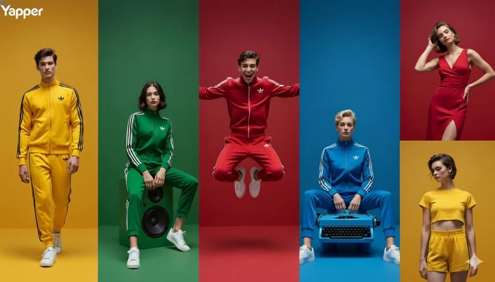

# Cherry 2.O — by @Mind_Boticni

[← Back to Examples from X](../../EXAMPLES.md) · Category: Poster Design · Model: `Nano Banana`

<a href="https://x.com/Mind_Boticni/status/2033403443269030215"></a>

Original post: **[@Mind_Boticni on X](https://x.com/Mind_Boticni/status/2033403443269030215)** · Creator: [Cherry 2.O](https://x.com/Mind_Boticni)

## Prompt

```text
A high-quality, split-screen fashion editorial advertisement featuring multiple panels of different colors (yellow, green, deep red, blue). The image shows models wearing Adidas-style tracksuits and casual sportswear in corresponding colors that match their background panel. One male model in yellow is walking, one female model in green is sitting on a speaker, one male model in red is jumping, one female model in blue is sitting by a blue typewriter, one female model in red is posing in a red panel, and one female model in yellow is standing. Clean studio lighting, vibrant solid-color backgrounds, professional fashion photography, minimalist aesthetic, sharp focus
```

## Try it

Paste the prompt into **[vinano.ai](https://vinano.ai?utm_source=github&utm_medium=readme&utm_campaign=awesome-image-video-prompts-updating&utm_content=x-page-try)** to generate your own version.

> The image and prompt belong to [@Mind_Boticni](https://x.com/Mind_Boticni) and are shown here with credit for reference. Creators can ask for changes or removal by opening an issue.
