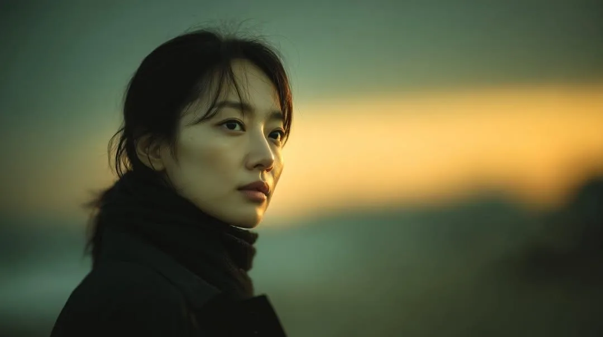

# K — by @ChillaiKalan__

[← Back to Examples from X](../../EXAMPLES.md) · Category: Photography · Model: `Nano Banana`

<a href="https://x.com/ChillaiKalan__/status/2022635065910464957"></a>

Original post: **[@ChillaiKalan__ on X](https://x.com/ChillaiKalan__/status/2022635065910464957)** · Creator: [K](https://x.com/ChillaiKalan__)

## Prompt

```text
Photorealistic cinematic portrait of a young East Asian woman standing outdoors at sunset, side-profile close-up, looking thoughtfully into the distance. Soft golden hour lighting illuminating one side of her face, warm orange and teal color grading. She wears a black coat and dark scarf, hair loosely tied back with soft natural strands around her face. Natural skin texture, realistic facial details, minimal makeup. Shallow depth of field with blurred landscape background, smooth bokeh, dramatic atmospheric mood, soft gradient sky transitioning from warm orange to cool green tones. Shot on 85mm lens, f/1.8, ultra-realistic, high dynamic range, cinematic composition, moody, film still aesthetic.
```

## Try it

Paste the prompt into **[vinano.ai](https://vinano.ai?utm_source=github&utm_medium=readme&utm_campaign=awesome-image-video-prompts-updating&utm_content=x-page-try)** to generate your own version.

> The image and prompt belong to [@ChillaiKalan__](https://x.com/ChillaiKalan__) and are shown here with credit for reference. Creators can ask for changes or removal by opening an issue.
