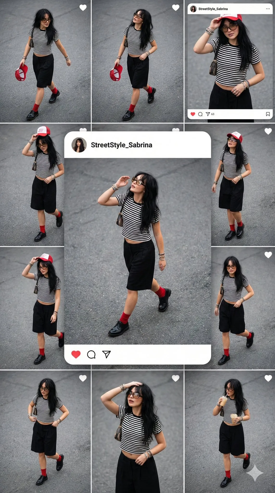

# Lex — by @lexx_aura

[← Back to Community Examples](../../EXAMPLES.md) · Category: Photography · Model: `Nano Banana`

<a href="https://x.com/lexx_aura/status/2009220608026939630"></a>

Source: **[@lexx_aura on X](https://x.com/lexx_aura/status/2009220608026939630)** · Creator: [Lex](https://x.com/lexx_aura)

## Prompt

```text
{
  "request_type": "image_generation_prompt",
  "source_material": {
    "input_required": true,
    "description": "User uploaded image for face reference."
  },
  "technical_specs": {
    "resolution": "64K DSLR shot resolution",
    "aspect_ratio": "9:16",
    "render_engines": [
      "Octane Render",
      "Unreal Engine 5"
    ],
    "realism_level": "High-resolution realism"
  },
  "composition": {
    "perspective": "High-angle, top-down view",
    "layout_style": "Modern social media grid (Instagram feed concept)",
    "layout_structure": {
      "central_element": "Larger, framed highlighted post",
      "surrounding_elements": "Clean grid pattern formed by smaller images"
    },
    "content_type": "Dynamic, urban street-style photo collage",
    "ui_overlay": {
      "enabled": true,
      "style": "Minimal social media interface mimicry",
      "elements": [
        "White rounded rectangles showing a username",
        "Subtle heart icons",
        "Minimal interaction indicators"
      ]
    }
  },
  "subject": {
    "identity": {
      "description": "Young woman",
      "facial_reference": "Same face as the uploaded image"
    },
    "appearance": {
      "hair": "Long black hair, worn loose and slightly messy",
      "vibe": "Confident, edgy, effortlessly cool"
    },
    "clothing": {
      "top": "Black-and-white horizontal striped cropped T-shirt",
      "bottom": "Loose black knee-length shorts",
      "footwear": {
        "shoes": "Polished black leather shoes",
        "socks": "Bright red socks"
      },
      "eyewear": "Oversized tinted sunglasses"
    },
    "accessories": {
      "headwear": {
        "item": "Red-and-white baseball cap",
        "usage": "Sometimes worn, sometimes held in hand"
      },
      "bag": "Small shoulder bag",
      "jewelry": "Stacked bracelets",
      "other": "Takeaway drink cup"
    },
    "actions_and_poses": {
      "style": "Candid moments captured in motion, not posed",
      "examples": [
        "Walking along the street",
        "Walking mid-step",
        "Adjusting cap",
        "Looking up toward camera",
        "Fixing bag",
        "Holding drink"
      ],
      "narrative_effect": "Natural lifestyle storytelling, varying poses across frames"
    }
  },
  "environment": {
    "setting": "Asphalt city street",
    "ground_surface": "Textured gray asphalt, minimal and uncluttered",
    "role": "Neutral backdrop emphasizing fashion and movement"
  },
  "lighting_and_color": {
    "lighting_type": "Natural daylight with soft shadows",
    "photographic_feel": "Realistic street photography",
    "color_palette": {
      "base": "Muted and urban tones",
      "contrast_accents": ["Bright red socks", "Red-and-white cap"]
    }
  },
  "style_and_mood": {
    "overall_mood": "Candid, contemporary, effortlessly cool",
    "aesthetic_blend": [
      "Fashion photography",
      "Street culture",
      "Social media aesthetics"
    ],
    "keywords": [
      "Urban street photography",
      "Top-down perspective",
      "Instagram grid layout",
      "Candid lifestyle shots",
      "Street fashion",
      "Casual cool aesthetic",
      "Muted city tones",
      "Social media UI overlay",
      "Natural light",
      "Modern editorial style"
    ]
  }
}
```

## Try it

Paste the prompt into **[vinano.ai](https://vinano.ai?utm_source=github&utm_medium=readme&utm_campaign=awesome-image-video-prompts-updating&utm_content=x-page-try)** to generate your own version.

> The image and prompt belong to @lexx_aura ([original post](https://x.com/lexx_aura/status/2009220608026939630)) and are shown here with credit for reference. Creators can ask for changes or removal by opening an issue.
