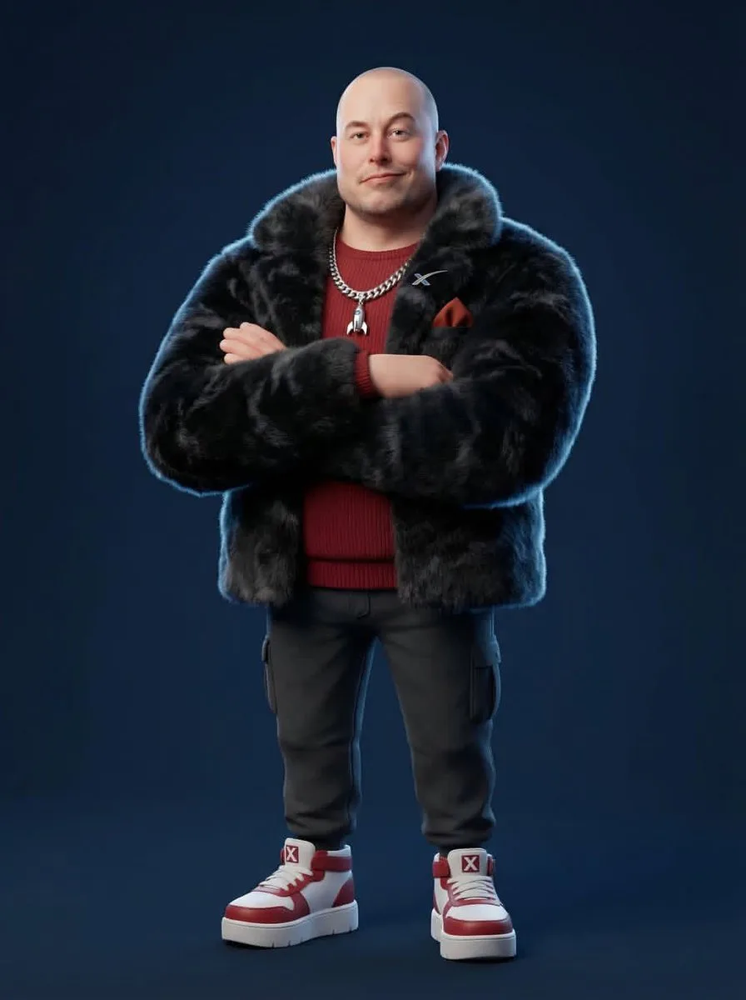

# Zar⭕on — by @Xaroon_x

[← Back to Community Examples](../../EXAMPLES.md) · Category: Illustration & 3D · Model: `Nano Banana`

<a href="https://x.com/Xaroon_x/status/2031735211772317828"></a>

Source: **[@Xaroon_x on X](https://x.com/Xaroon_x/status/2031735211772317828)** · Creator: [Zar⭕on](https://x.com/Xaroon_x)

## Prompt

```text
{
  "renderEngine": "Blender Cycles / Unreal Engine 5 Lumen",
  "baseStyle": "Stylized 3D CGI character — Pixar meets high-fashion editorial",
  "proportions": "Slightly enlarged head (1.3x natural), compact torso, simplified facial features, exaggerated chunky feet/shoes",
  "skinShader": "Subsurface scattering with physically-based roughness, no pores, smooth cartoon-like finish",
  "clothingPhysics": "Marvelous Designer simulation baked in, wrinkle maps, fabric-specific material shaders",
  "furTech": "XGen or Ornatrix volumetric fur for faux-fur pieces, physics-simulated",
  "resolution": "8192x8192px minimum, 300DPI",
  "backgroundStyle": "Solid flat color, no gradient, no texture — studio seamless backdrop",
  "lightingRig": "Three-point studio: key (45° front-top), fill (opposite side soft), rim (back edge definition)",
  "cameraLens": "35-50mm equivalent, slight vignette, no fisheye",
  "postProcessing": "Subtle chromatic aberration on edges, mild film grain 2%, slight color grade"
}
```

## Try it

Paste the prompt into **[vinano.ai](https://vinano.ai?utm_source=github&utm_medium=readme&utm_campaign=awesome-image-video-prompts-updating&utm_content=x-page-try)** to generate your own version.

> The image and prompt belong to @Xaroon_x ([original post](https://x.com/Xaroon_x/status/2031735211772317828)) and are shown here with credit for reference. Creators can ask for changes or removal by opening an issue.
