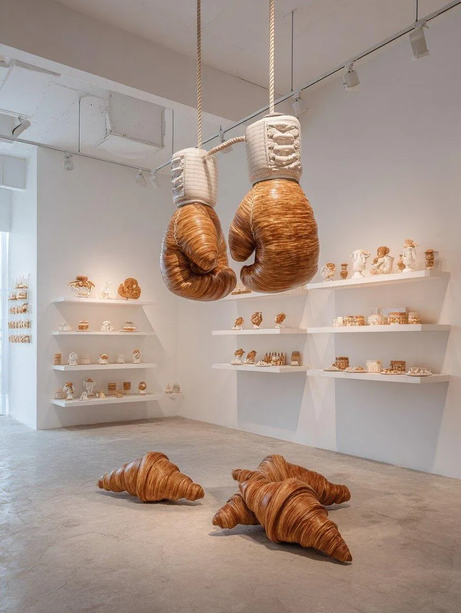

# Sharon Riley — by @Just_sharon7

[← Back to Examples from X](../../EXAMPLES.md) · Category: Food & Drink · Model: `Nano Banana`

<a href="https://x.com/Just_sharon7/status/2012019416884789443"></a>

Original post: **[@Just_sharon7 on X](https://x.com/Just_sharon7/status/2012019416884789443)** · Creator: [Sharon Riley](https://x.com/Just_sharon7)

## Prompt

```text
{
  "scene": "Minimalist white contemporary art gallery",
  "environment": {
    "floor": "smooth concrete floor",
    "lighting": "soft warm museum lighting",
    "atmosphere": "clean, surreal, high-end contemporary museum aesthetic"
  },
  "main_subject": {
    "description": "Oversized sports equipment sculpture made entirely from croissants",
    "material": "hyper-realistic golden flaky croissant pastry",
    "sports_equipment_options": [
      "boxing gloves",
      "dumbbells",
      "basketballs",
      "kettlebells",
      "barbell"
    ],
    "placement": "center of the gallery on white pedestal",
    "scale": "oversized, dominant focal point"
  },
  "secondary_elements": {
    "floating_shelves": "white floating shelves on walls",
    "miniature_objects": "tiny pastry-based sports objects and croissant sculptures",
    "arrangement": "evenly spaced, gallery-style display"
  },
  "visual_style": {
    "texture_detail": "ultra-realistic pastry layers, crisp flaky edges, buttery sheen",
    "color_palette": "white, warm gold, soft beige",
    "composition": "symmetrical, minimal, museum exhibition layout"
  },
  "photography": {
    "style": "professional photography",
    "camera": "high-resolution, sharp focus",
    "depth_of_field": "subtle depth, gallery clarity",
    "quality": "ultra-detailed, premium art photography"
  }
}
```

## Try it

Paste the prompt into **[vinano.ai](https://vinano.ai?utm_source=github&utm_medium=readme&utm_campaign=awesome-image-video-prompts-updating&utm_content=x-page-try)** to generate your own version.

> The image and prompt belong to [@Just_sharon7](https://x.com/Just_sharon7) and are shown here with credit for reference. Creators can ask for changes or removal by opening an issue.
