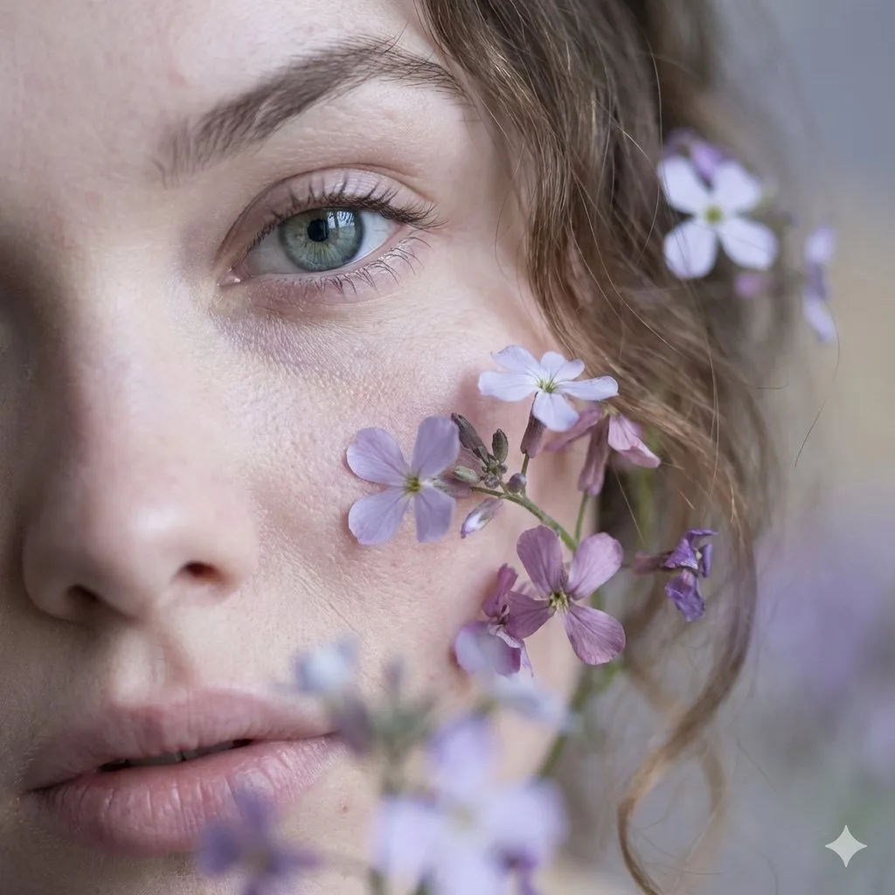

# Anissa — by @SimplyAnnisa

[← Back to Community Examples](../../EXAMPLES.md) · Category: Photography · Model: `Nano Banana`

<a href="https://x.com/SimplyAnnisa/status/2010578685070582235"></a>

Source: **[@SimplyAnnisa on X](https://x.com/SimplyAnnisa/status/2010578685070582235)** · Creator: [Anissa](https://x.com/SimplyAnnisa)

## Prompt

```text
Utilize exclusively and obligatorily the uploaded reference photos as the primary and authoritative source for the model’s face, facial structure, proportions, skin tone, real skin texture, and the exact natural characteristics of her hair.
Do not idealize, beautify, alter, rejuvenate, slim the face, smooth the skin, or modify any real features.
Do not remove or change freckles, pores, fine lines, or natural imperfections.The appearance must match the reference images exactly, with absolute fidelity.
Create a hyper-realistic, ethereal macro Fine Art portrait photograph, captured with a Leica APO-Macro-Elmarit-R 100mm f/2.8, full-frame.
An extreme close-up of a young woman’s face with pale skin, fully respecting the real physiognomy of the model as shown in the reference photos.
Skin texture is ultra-detailed and completely natural, with clearly visible pores and no artificial smoothing.
One crystal-clear, melancholic eye is in perfect critical focus, displaying natural micro-contrast characteristic of Leica optics.
Long, natural eyelashes.
Lips slightly parted, in a natural pale pink tone, with no excessive or artificial makeup.
Delicate wildflowers in soft lilac and muted purple tones rest gently on the cheek and intertwine with loose, naturally imperfect hair strands, exactly following the real hair pattern seen in the reference images.
Some flowers appear softly out of focus in the foreground, creating organic depth and layered composition.
Soft, cool, diffused natural light, as on an overcast day.
No harsh shadows, no artificial lighting.
A serene, fragile, poetic, and subtly melancholic atmosphere.
Macro photography with an extremely shallow depth of field, edges and background melting into a creamy, smooth bokeh.
Absolute critical focus on the iris and the true skin texture.
Desaturated color palette, cool pastel tones — soft gray, beige, and lilac.
Fine Art aesthetic, authentic Leica optical fidelity, true photographic appearance.
Ultra-high resolution 8K, with no AI-generated look.
```

## Try it

Paste the prompt into **[vinano.ai](https://vinano.ai?utm_source=github&utm_medium=readme&utm_campaign=awesome-image-video-prompts-updating&utm_content=x-page-try)** to generate your own version.

> The image and prompt belong to @SimplyAnnisa ([original post](https://x.com/SimplyAnnisa/status/2010578685070582235)) and are shown here with credit for reference. Creators can ask for changes or removal by opening an issue.
