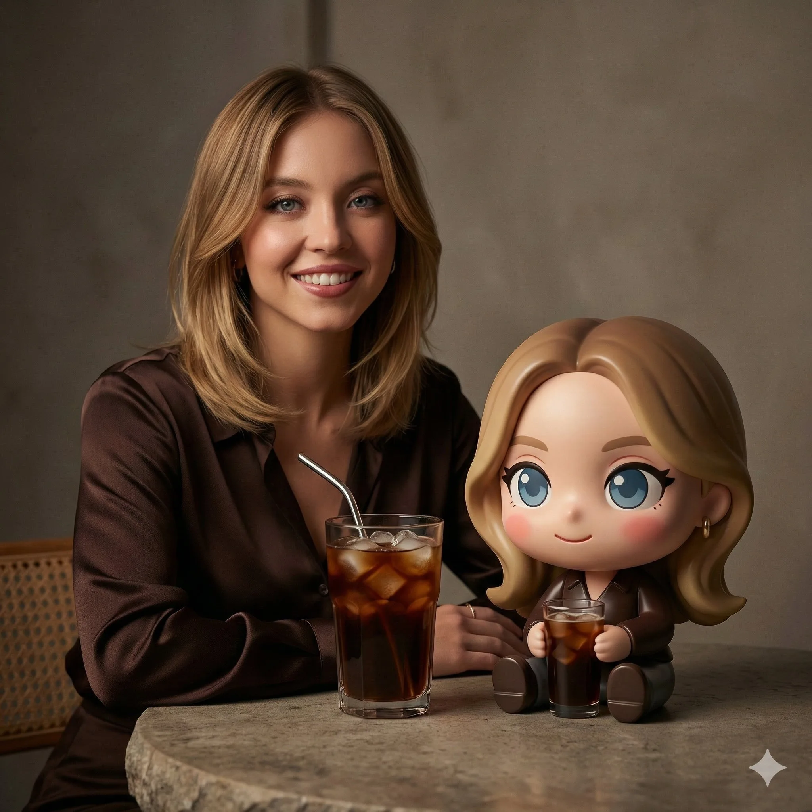

# Synthia — by @AIwithSynthia

[← Back to Examples from X](../../EXAMPLES.md) · Category: Illustration & 3D · Model: `Nano Banana`

<a href="https://x.com/AIwithSynthia/status/2010213849618886946"></a>

Original post: **[@AIwithSynthia on X](https://x.com/AIwithSynthia/status/2010213849618886946)** · Creator: [Synthia](https://x.com/AIwithSynthia)

## Prompt

```text
A cinematic studio portrait of a woman seated at a textured stone table against a muted warm gray background. She wears a dark brown satin blouse, subtle evening makeup, and softly layered shoulder-length hair. In front of her is a glass of cold brew coffee with ice and a metal straw. Placed beside it is a glossy 3D chibi figurine of the same woman, with a big rounded head, expressive eyes, soft blush cheeks, and simplified facial features, holding a miniature cold brew glass. The chibi has a high-quality collectible toy look with gentle reflections. Intimate evening café vibe, moody soft lighting, shallow depth of field, realistic human combined with stylized 3D character, cinematic and cozy, 1:1 aspect ratio.
```

## Try it

Paste the prompt into **[vinano.ai](https://vinano.ai?utm_source=github&utm_medium=readme&utm_campaign=awesome-image-video-prompts-updating&utm_content=x-page-try)** to generate your own version.

> The image and prompt belong to [@AIwithSynthia](https://x.com/AIwithSynthia) and are shown here with credit for reference. Creators can ask for changes or removal by opening an issue.
