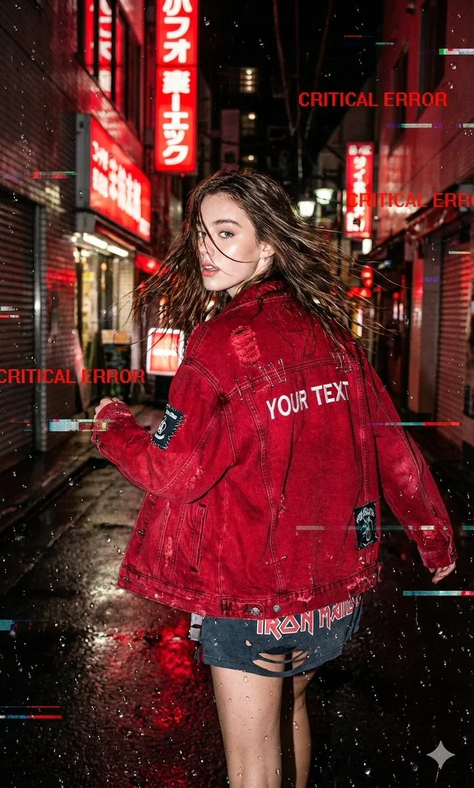

# Harboriis — by @harboriis

[← Back to Community Examples](../../EXAMPLES.md) · Category: Photography · Model: `Nano Banana`

<a href="https://x.com/harboriis/status/2011634939490672664"></a>

Source: **[@harboriis on X](https://x.com/harboriis/status/2011634939490672664)** · Creator: [Harboriis](https://x.com/harboriis)

## Prompt

```text
A raw, candid street-style shot of reference running through a rain-soaked Neo-Tokyo alleyway, glancing over her shoulder. She is wearing an oversized "Crimson Red" distressed denim jacket with safety pins and patches, the [YOUR TEXT] branding is embroidered in white on the back. Underneath, a torn band tee. Raindrops on the camera lens create natural distortion. The background is blurred red neon signs reflecting on wet asphalt. The image is heavily processed with "Critical Error" red text overlays and glitch artifacts. Style: Flash photography, high contrast, adrenaline rush.
```

## Try it

Paste the prompt into **[vinano.ai](https://vinano.ai?utm_source=github&utm_medium=readme&utm_campaign=awesome-image-video-prompts-updating&utm_content=x-page-try)** to generate your own version.

> The image and prompt belong to @harboriis ([original post](https://x.com/harboriis/status/2011634939490672664)) and are shown here with credit for reference. Creators can ask for changes or removal by opening an issue.
