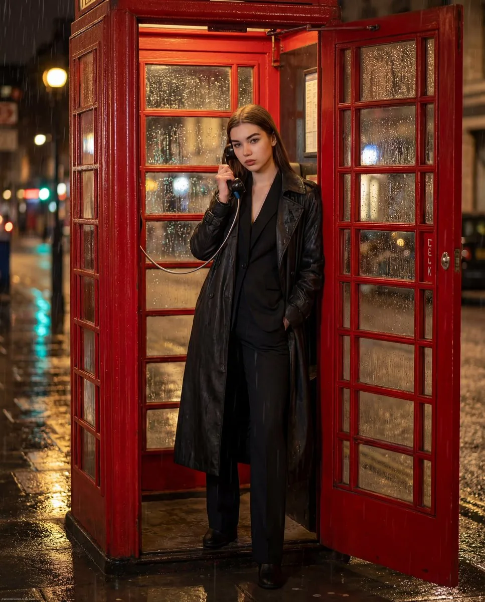

# 𝗦𝗮𝗻𝗶𝗮 — by @saniaspeaks_

[← Back to Examples from X](../../EXAMPLES.md) · Category: Photography · Model: `Nano Banana`

<a href="https://x.com/saniaspeaks_/status/2025153830552494523"></a>

Original post: **[@saniaspeaks_ on X](https://x.com/saniaspeaks_/status/2025153830552494523)** · Creator: [𝗦𝗮𝗻𝗶𝗮](https://x.com/saniaspeaks_)

## Prompt

```text
{
  "type": "image_generation_prompt",
  "style": "ultra-photorealistic, cinematic, high-end fashion editorial",
  "aspect_ratio": "1:1",
  "resolution": "high resolution, maximum realism",
  "scene": {
    "time": "night",
    "weather": "rainy",
    "location": "urban London street"
  },
  "environment": {
    "primary_setting": "inside a classic red British telephone booth",
    "ground": "wet pavement reflecting city lights",
    "atmosphere": [
      "visible raindrops under soft street lighting",
      "subtle fog in the background",
      "blurred headlights",
      "cinematic bokeh lights"
    ]
  },
  "subject": {
    "gender": "female",
    "appearance": {
      "physique": "fit, elegant, confident presence",
      "expression": "serious, confident, charismatic",
      "pose": {
        "full_body_visible": true,
        "stance": "standing inside the telephone booth",
        "right_hand": "holding the old-fashioned phone receiver",
        "left_hand": "casually inside coat pocket"
      }
    },
    "clothing": {
      "outfit": "tailored black suit",
      "outerwear": "long dark trench coat slightly wet from rain",
      "style": "elegant, cinematic, fashion editorial"
    }
  },
  "lighting": {
    "type": "moody cinematic street lighting",
    "effects": [
      "dramatic contrast",
      "realistic rain reflections on glass panels",
      "soft highlights on wet surfaces",
      "natural reflections from city lights"
    ]
  },
  "camera": {
    "framing": "full-body shot from head to toe",
    "composition": "centered subject inside telephone booth",
    "focus": "sharp focus on subject, soft blur in background",
    "style": "cinematic photography"
  },
  "mood": {
    "tone": "dark, elegant, cinematic",
    "aesthetic": "high-end fashion editorial with urban atmosphere"
  },
  "constraints": [
    "no cartoon or illustration",
    "no unrealistic lighting",
    "no distortion",
    "no watermark",
    "no text"
  ],
  "output_goal": "Create an ultra-photorealistic cinematic night scene of a confident woman standing inside a classic red British telephone booth in rainy London, with dramatic lighting, realistic reflections, and a high-end fashion editorial aesthetic."
}
```

## Try it

Paste the prompt into **[vinano.ai](https://vinano.ai?utm_source=github&utm_medium=readme&utm_campaign=awesome-image-video-prompts-updating&utm_content=x-page-try)** to generate your own version.

> The image and prompt belong to [@saniaspeaks_](https://x.com/saniaspeaks_) and are shown here with credit for reference. Creators can ask for changes or removal by opening an issue.
