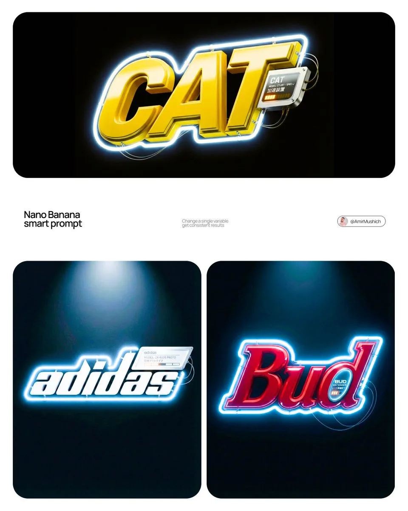

# AmirMušić — by @AmirMushich

[← Back to Examples from X](../../EXAMPLES.md) · Category: Product & Brand · Model: `Nano Banana`

<a href="https://x.com/AmirMushich/status/2044483455094845909"></a>

Original post: **[@AmirMushich on X](https://x.com/AmirMushich/status/2044483455094845909)** · Creator: [AmirMušić](https://x.com/AmirMushich)

## Prompt

```text
[BRAND NAME] | [COLOR]

Act as a 3D Motion Graphics Director and CGI Type Artist specializing in Japanese streetwear, Y2K motorsport aesthetics, and retro-tech hardware design. References: Kawasaki Racing livery, Yasuhiro Nightow title cards, Wipeout game UI, Peak Design × Japanese hardware collab.

PHASE 0: BRAND LOGO INTELLIGENCE

Retrieve the canonical logotype of [BRAND NAME] from training data. Identify its core typographic DNA — stroke weight, angle of italic lean, terminal style, any custom glyph cuts. If [BRAND NAME] uses a geometric or sans-serif wordmark — apply a 15 to 20° italic transformation while preserving all letterform proportions. If [BRAND NAME] already uses italic or script — preserve its native angle exactly. The goal is to translate the brand's typographic identity into a Japanese motorsport script register — aerodynamic, forward-leaning, built for speed. The letters must remain recognizable as [BRAND NAME]'s typeface, not replaced with a generic racing font.

PHASE 1: PRIMARY TYPOGRAPHY SCULPTURE

The wordmark of [BRAND NAME] is a fully 3D object — thick, physical, occupying real depth. Form language: each letter has a flat front face, beveled top and bottom edges with 30 to 45° chamfer cuts — the kind of angular geometry found on Japanese racing fairings and Kawasaki tank badges. Letters are slightly condensed and heavily italic — forward momentum is built into the geometry. The overall silhouette reads as one unified aerodynamic form — letters connect at their bases through a common ground plane, like a single cast aluminum piece. Material: high-gloss automotive lacquer in [COLOR] — the same paint system as a Japanese sports motorcycle tank. Surface properties: IOR 1.6, roughness 0.05, clear-coat depth visible. [COLOR] is pure and saturated in midtones, pushing toward near-white in specular peaks, pulling toward deep shadow in recessed zones and chamfer undersides. Reflections on the front face: subtle dark environment reflections — minimal and moody, just enough to show material depth. Top chamfer faces catch the primary light as bright highlight strips — the signature detail that defines 3D volume.

PHASE 2: NEON WIRE OUTLINE SYSTEM

A continuous neon tube traces the exact outer silhouette contour of the entire wordmark — every letter edge, every chamfer angle, every connecting point between letters. This is not a glow effect or a stroke — it is a physical glass neon tube, 4 to 6mm diameter, bent precisely to follow the letterform outline at a 3 to 5mm offset distance from the letter surface. Neon tube properties: glass tube body is semi-transparent — internal plasma glow visible through glass. Light emission: bright cold white light, color temperature 7000 to 8000K, pure white with very slight blue-cool bias. Emitted light creates a tight halo of illumination — 8 to 15mm radius soft glow on surrounding black void. The neon light bounces onto nearest letter surfaces — edges adjacent to the tube receive subtle cool white rim light. Tube construction: clean geometric bends at sharp corners, thin mounting wire clips at 3 to 4 points along its length — technically precise, like real neon sign hardware.

PHASE 3: INTEGRATED TECHNICAL SCREEN

A hardware screen panel is physically integrated with the wordmark — not a separate floating element, not placed at a distance. Integration logic — autonomously determine the most natural attachment point based on [BRAND NAME]'s logo geometry, choosing ONE of these integration modes: OVERLAP MODE — the screen panel is partially overlaid onto the rightmost or leftmost letter of the wordmark, as if mounted directly on the letter face. The letter surface shows through the screen's transparent zones. The screen edge cuts across the letter geometry deliberately — like a sticker or plate bolted onto the sculpture. EXTENSION MODE — the screen panel extends directly from the end of the final letter as a seamless continuation of the wordmark's ground plane — same italic angle, same 3D depth, as if the wordmark was designed with this panel as part of its original form. The transition from letter to screen feels like one continuous designed object. INSET MODE — the screen panel sits in a recess cut into one of the larger letters — as if a rectangular section of the letter body was removed and replaced with a hardware display. The letter geometry frames the screen on three sides.

Screen physical construction: machined aluminum or brushed steel housing, same thickness as the letter sculpture — 8 to 12mm deep. The face is a slightly frosted acrylic panel backlit from within. The screen has the same italic angle as the wordmark — it is not upright, it leans with the composition. Screen contents rendered in precise small-scale detail: [BRAND NAME] in small clean technical sans-serif as primary label. An alphanumeric model code autonomously generated to feel authentic to [BRAND NAME]'s cultural language. 2 to 3 Japanese characters as secondary label. A horizontal LED progress bar — 4 to 6 rectangular segments, 1 to 2 lit in amber, others dark. A small ventilation grille or mesh pattern along one edge of the housing. The screen connects to the neon outline system via 1 to 2 thin cables — physical wires, 1 to 2mm diameter, with slight organic sag from gravity, running to the nearest neon tube mounting clip.

PHASE 4: LIGHTING & ATMOSPHERE

Background: pure absolute black (#000000 to #030303) — complete void, no ambient, no gradient, no surface. The composition is self-illuminated — only light sources are the neon tube emission, the screen's internal backlight, and a single narrow overhead spot. Overhead spot: focused directly above the wordmark center — illuminates top chamfer faces as bright highlight strips, falls off completely within 5 to 10cm of letterform edges, never reaches the background. Neon contribution: cool white rim light on adjacent letter edges, 8 to 15mm glow halo in surrounding void, reflected light on cables and screen housing. Screen contribution: the frosted acrylic face emits a soft diffused glow — slightly cooler than the neon, illuminating the immediate area of whichever letter the screen is integrated with. The amber LED segments create a warm micro-glow within the screen housing. No other light sources. No rim lights. No fill. Darkness is absolute outside self-illuminated zones.

PHASE 5: COMPOSITION

Aspect ratio: 1:1 square. The wordmark with integrated screen occupies the horizontal center — wider than tall, spreading laterally. The screen integration should feel like it was always part of the logo design — not an accessory bolted on, but a native component. Vertical position: slightly above center. The neon outline breaches the implied bounding box slightly at 1 to 2 points — confirming physical separation between neon tube and letter surface. Camera: slightly elevated 5 to 10° above center — reveals top chamfer faces and confirms 3D depth. Mild perspective. Depth of field: none — sharp across entire composition from screen detail to neon tube.

PHASE 6: TECH SPECS

Render: Octane Render or Redshift. Ray tracing: on — for accurate neon tube emission, screen backlight glow, glass refraction, cable shadows. Volumetric light: subtle around neon tube and screen face only — physically present glow without fogging the black void. Neon tube: dielectric glass material with physical light emission, not a glow map. Screen face: translucent acrylic with internal emissive backlight. Letter sculpture: automotive lacquer with full clear-coat depth. Anti-aliasing: maximum. Sampling: minimum 1024 samples. Film grain: none. Output feel: CGI title card or album cover — precision and atmosphere in equal measure. Darkness absolute. Neon and screen physically real.
```

## Try it

Paste the prompt into **[vinano.ai](https://vinano.ai?utm_source=github&utm_medium=readme&utm_campaign=awesome-image-video-prompts-updating&utm_content=x-page-try)** to generate your own version.

> The image and prompt belong to [@AmirMushich](https://x.com/AmirMushich) and are shown here with credit for reference. Creators can ask for changes or removal by opening an issue.
